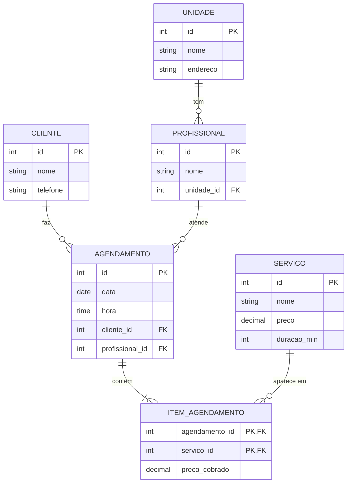
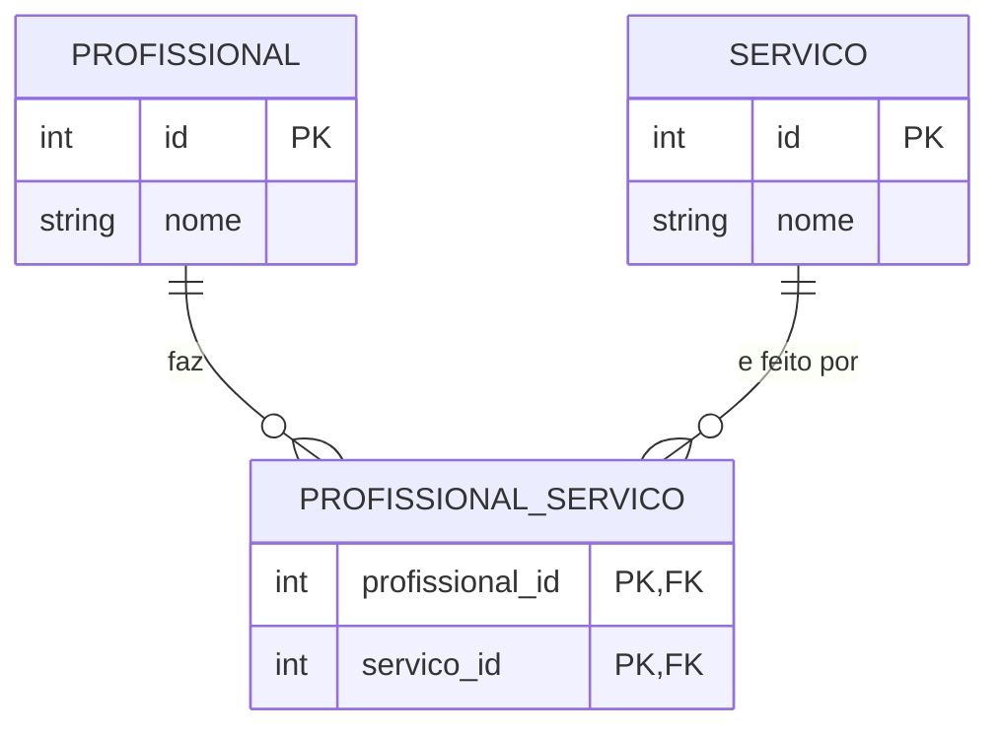
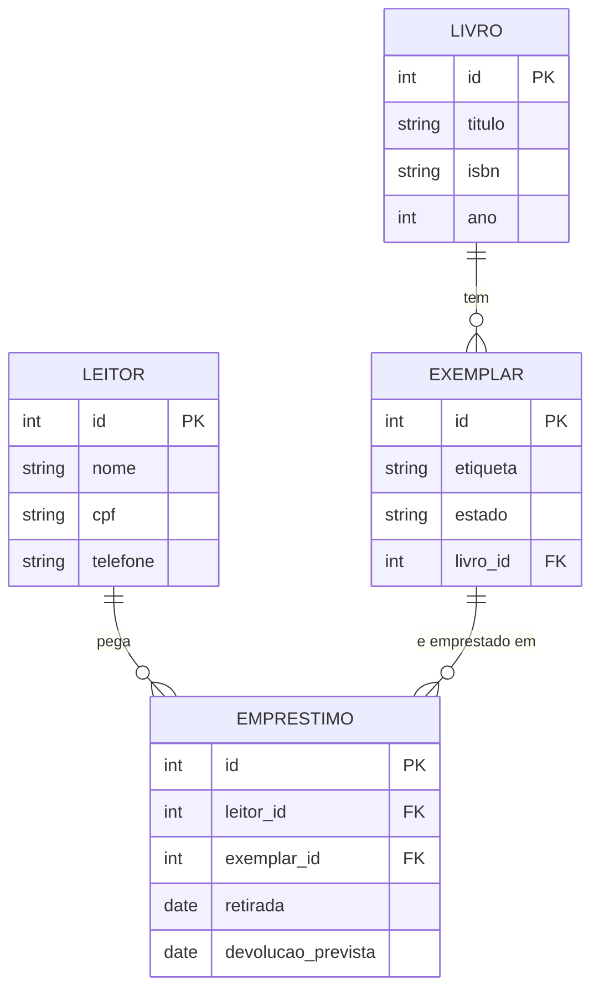
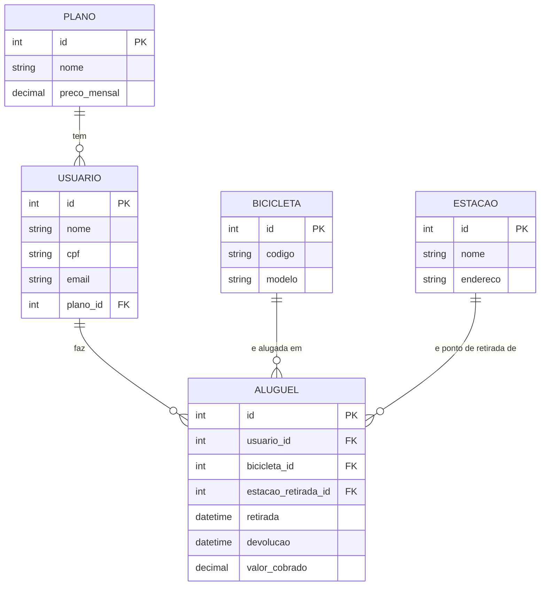
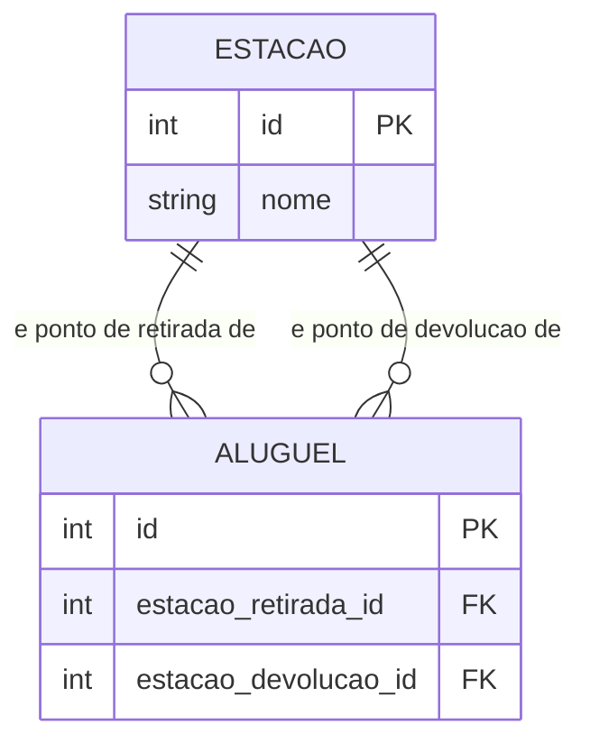

# ✅ Gabarito comentado

**Módulo 2 · Aula 1: Modelagem relacional + Cardinalidade e normalização**

Este arquivo tem as respostas do **exercício da aula** (o AgendaÁgil) e da **lista de exercícios para casa**.

> **Como usar o gabarito:** ele não serve para copiar. Serve para **comparar**. Primeiro tente resolver sozinho(a). Depois confira o seu modelo com o daqui. Em modelagem, **existe mais de um caminho certo**: se o seu DER tem nomes diferentes, mas as mesmas entidades, as mesmas ligações e **nenhuma informação repetida**, o seu modelo também está certo.
>
> Se o seu modelo ficou diferente, não apague tudo. Compare **entidade por entidade** com o gabarito e descubra onde está a diferença. Esse é o momento em que você mais aprende.

---

## 📑 Sumário

- [✅ Gabarito comentado](#-gabarito-comentado)
  - [📑 Sumário](#-sumário)
  - [👥 Exercício da aula: o AgendaÁgil](#-exercício-da-aula-o-agendaágil)
    - [O DER final](#o-der-final)
    - [Um exemplo de `modelo-normalizado.md`](#um-exemplo-de-modelo-normalizadomd)
    - [Por que funciona, passo a passo](#por-que-funciona-passo-a-passo)
    - [🚀 Desafio extra: nem todo profissional faz todo serviço](#-desafio-extra-nem-todo-profissional-faz-todo-serviço)
    - [Resposta esperada para a pergunta em dupla](#resposta-esperada-para-a-pergunta-em-dupla)
  - [Exercício 1: Substantivos e verbos 🟢](#exercício-1-substantivos-e-verbos-)
  - [Exercício 2: Qual é a cardinalidade? 🟡](#exercício-2-qual-é-a-cardinalidade-)
  - [Exercício 3: Qual forma normal foi quebrada? 🟢](#exercício-3-qual-forma-normal-foi-quebrada-)
  - [Exercício 4: Do zero ao DER: o BikeÁgil 🔴](#exercício-4-do-zero-ao-der-o-bikeágil-)
    - [O DER](#o-der)
    - [As tabelas finais, com os dados da planilha](#as-tabelas-finais-com-os-dados-da-planilha)
    - [Por que funciona](#por-que-funciona)
    - [Exemplos de resposta para os comentários (item 6)](#exemplos-de-resposta-para-os-comentários-item-6)
    - [Para ir além (bônus): devolver em outra estação](#para-ir-além-bônus-devolver-em-outra-estação)
  - [❓ Dúvidas que costumam aparecer](#-dúvidas-que-costumam-aparecer)

---

## 👥 Exercício da aula: o AgendaÁgil

### O DER final

O GitHub desenha este diagrama para você:



As **tabelas finais**, com os dados da planilha já distribuídos:

`UNIDADE`

| id | nome | endereco |
|---|---|---|
| 1 | Centro | Rua A, 10 |
| 2 | Orla | Av. B, 200 |

`PROFISSIONAL`

| id | nome | unidade_id |
|---|---|---|
| 1 | Léo | 1 |
| 2 | Bia | 2 |

`CLIENTE`

| id | nome | telefone |
|---|---|---|
| 1 | Marina Alves | (71) 99999-0001 |
| 2 | Diego Costa | (71) 99999-0002 |

`SERVICO`

| id | nome | preco | duracao_min |
|---|---|---|---|
| 1 | Corte | 40 | 30 |
| 2 | Barba | 25 | 20 |
| 3 | Sobrancelha | 15 | 15 |

`AGENDAMENTO`

| id | data | hora | cliente_id | profissional_id |
|---|---|---|---|---|
| 1 | 2026-11-10 | 14:00 | 1 | 1 |
| 2 | 2026-11-10 | 15:00 | 2 | 2 |
| 3 | 2026-11-12 | 10:00 | 1 | 1 |

`ITEM_AGENDAMENTO`

| agendamento_id | servico_id | preco_cobrado |
|---|---|---|
| 1 | 1 | 40 |
| 1 | 2 | 25 |
| 2 | 1 | 40 |
| 3 | 3 | 15 |

> **Prova de que nada se perdeu:** juntando estas seis tabelas pelos `id`, você reconstrói exatamente as 4 linhas da planilha do Passo 5. Normalizar **não joga informação fora**: só põe cada coisa no seu lugar.

### Um exemplo de `modelo-normalizado.md`

```markdown
# Modelo normalizado: AgendaÁgil

## UNIDADE
- id (PK)
- nome
- endereco

## PROFISSIONAL
- id (PK)
- nome
- unidade_id (FK → UNIDADE)

## CLIENTE
- id (PK)
- nome
- telefone

## SERVICO
- id (PK)
- nome
- preco (preço de tabela, pode mudar)
- duracao_min

## AGENDAMENTO
- id (PK)
- data
- hora
- cliente_id (FK → CLIENTE)
- profissional_id (FK → PROFISSIONAL)

## ITEM_AGENDAMENTO
- agendamento_id (PK, FK → AGENDAMENTO)
- servico_id (PK, FK → SERVICO)
- preco_cobrado (o preço do dia)
```

### Por que funciona, passo a passo

- **Passo 1:** as **5 entidades** são os substantivos que têm dados próprios. `endereco`, `preco`, `duracao`, `data`, `hora` e `telefone` são **campos** de alguma entidade, não entidades. Os verbos ligam as entidades: a unidade **tem** profissionais, o cliente **faz** agendamentos, o profissional **atende**, o agendamento **contrata** serviços.
- **Passo 2:** cada entidade ganha um `id` como PK. O telefone é do **cliente** (e não do agendamento), e o endereço é da **unidade**.
- **Passo 3:** as três ligações com a unidade, o cliente e o profissional são **1:N**: a FK fica **no lado "muitos"**. A ligação entre **agendamento e serviço** é **N:N**: um agendamento tem vários serviços, e um serviço aparece em vários agendamentos. Por isso nasce o **`ITEM_AGENDAMENTO`**, com duas FKs (que juntas formam a PK).
- **Passo 4:** conferindo o **checklist**: toda entidade tem PK; toda FK tem linha; **nenhuma N:N direta**; toda linha tem verbo e `1`/`N`. A tabela associativa em **verde** é o sinal de que o N:N foi resolvido.
- **Passo 5 (1FN):** a lista dentro das células de `servicos`, `precos` e `duracoes` viola a 1FN. O agendamento 1 vira **duas linhas** (Corte e Barba). A chave agora é **(agendamento, servico)**.
- **Passo 6 (2FN):** com a chave **(agendamento, servico)**, tudo que descreve **o agendamento** (data, hora, cliente, telefone, profissional, unidade e endereço) depende só de uma parte da chave. A `duracao` depende só do **serviço**. O **preço cobrado** depende **dos dois**: é o preço daquele serviço **naquele dia**. Por isso ele fica no item (`preco_cobrado`). O serviço também ganha um `preco` de **tabela**, que é um campo novo (o preço de hoje).
- **Passo 7 (3FN):** em `AGENDAMENTO`, o `telefone` depende do **cliente**, e o `endereco_unidade` depende da **unidade**, que depende do **profissional**. É uma cadeia: **agendamento → profissional → unidade → endereço**. Cada elo vira uma tabela, e passamos a usar `id`.
- **Passo 8 (conferir):** o telefone da Marina fica **em um lugar só** (na planilha do Passo 5, ele aparecia em 3 linhas). O endereço do Centro também (na planilha, 3 linhas). E o `preco_cobrado` **não muda** quando o preço de tabela sobe: é o preço do dia.

**Outra forma que também está certa:**
- Chamar a tabela associativa de `SERVICO_AGENDADO` (ou outro nome claro).
- Deixar `unidade` como um simples **atributo** do profissional **se** o endereço não importasse. Aqui o endereço depende da unidade e se repete, então **entidade** é a escolha certa.

### 🚀 Desafio extra: nem todo profissional faz todo serviço

1. **Cardinalidade: N:N.** Um profissional faz vários serviços, e um serviço é feito por vários profissionais. **Falta uma tabela:** a `PROFISSIONAL_SERVICO`, com duas FKs.



2. **Discordância Positiva (resposta aberta, qualquer argumento vale).**
   - **A favor de impedir:** evita marcar um corte com quem só faz barba. O dado já está no modelo, então o sistema pode conferir.
   - **Contra impedir (no banco):** regras assim mudam muito (um profissional aprende um serviço novo) e deixam o modelo rígido. É melhor conferir **no código** (com Zod, como no M1) e deixar o modelo simples.
   - O importante é **defender com motivo**.

### Resposta esperada para a pergunta em dupla

Qualquer resposta com a mesma ideia vale:
- **Para a barbearia:** o serviço tem um preço de tabela que **muda**. Se o agendamento de ontem lesse sempre o preço de hoje, o **faturamento do passado mudaria sozinho**.
- **Para a cliente:** ela combinou e pagou um preço. Se o valor mudasse depois, ela receberia uma cobrança diferente do que foi combinado.

---

## Exercício 1: Substantivos e verbos 🟢

**Resultado esperado:**

- **Entidades (4):** `Livro`, `Exemplar`, `Leitor` e `Emprestimo`.
- **Relacionamentos:** o livro **tem** exemplares; o leitor **pega** exemplares **emprestados**.
- **Atributos (exemplos):**
  - `Livro`: titulo, isbn, ano
  - `Exemplar`: etiqueta, estado
  - `Leitor`: nome, cpf, telefone
  - `Emprestimo`: data de retirada, data prevista de devolução

**Por que funciona:**
- **Livro e exemplar são coisas diferentes.** O livro é a **obra** (o título, o ISBN). O exemplar é a **cópia física** que alguém segura (tem etiqueta e estado). Sem separar, não dá para dizer "a biblioteca tem 3 cópias de um livro, e uma está danificada".
- `título`, `ano` e `telefone` são **campos**, não entidades.

**Exemplo de resposta para o comentário (item 4):** o empréstimo é uma **entidade**: ele tem **dados próprios** (as datas) e é o que **liga** o leitor ao exemplar. Na prática, é a **tabela associativa** que resolve o N:N entre Leitor e Exemplar.

Para quem quiser conferir como ficaria o DER:



---

## Exercício 2: Qual é a cardinalidade? 🟡

| Situação | Um A tem quantos B? | Um B tem quantos A? | Cardinalidade | FK ou tabela associativa |
|---|---|---|---|---|
| a) Cliente e Pedido | muitos | um | **1:N** | `cliente_id` em `PEDIDO` |
| b) Pedido e Produto | muitos | muitos | **N:N** | `ITEM_PEDIDO` (ex.: `quantidade`, `preco_unitario`) |
| c) Produto e Estoque | um | um | **1:1** | `produto_id` em `ESTOQUE` (que também é a PK) |
| d) Vendedor e Produto | muitos | um | **1:N** | `vendedor_id` em `PRODUTO` |
| e) Pedido e Cupom | muitos (até 2) | muitos | **N:N** | `PEDIDO_CUPOM` (duas FKs) |
| f) Leitor e Exemplar | muitos (ao longo do tempo) | muitos (ao longo do tempo) | **N:N** | `EMPRESTIMO` (ex.: `retirada`, `devolucao_prevista`) |

**Por que funciona:**
- **a e d:** o "muitos" é **pedido** (e **produto**), então a FK fica neles. Quem tem muitos **guarda o id** de quem tem um.
- **b, e e f:** os dois lados têm "muitos", então **nunca fica direto**: nasce uma terceira tabela, com **duas FKs**, e os dados do "encontro" moram nela.
- **c:** nos dois lados a resposta é "um". A FK pode ficar em qualquer lado; escolhemos o `ESTOQUE`, que depende do produto, e o `produto_id` vira a PK dele.
- **e:** o "até 2 cupons" é uma **regra de negócio** (vai para o código, com Zod). A cardinalidade continua N:N.
- **f:** olhe **ao longo do tempo**. O mesmo exemplar é emprestado a vários leitores (um de cada vez), e o mesmo leitor pega vários exemplares.

---

## Exercício 3: Qual forma normal foi quebrada? 🟢

**Tabela A: `contato` → 1FN**

A coluna `telefones` tem uma **lista numa célula** ("7199-1111, 7198-2222"). Fica:

`CONTATO`

| id | nome |
|---|---|
| 1 | Ana |
| 2 | Bruno |

`TELEFONE`

| id | contato_id | numero |
|---|---|---|
| 1 | 1 | 7199-1111 |
| 2 | 1 | 7198-2222 |
| 3 | 2 | 7197-3333 |

**Tabela B: `item_pedido` → 2FN**

A chave é composta (`pedido_id` + `produto_id`), e o `nome_produto` depende **só do `produto_id`** (uma parte da chave). Fica:

`PRODUTO`

| id | nome |
|---|---|
| 10 | Mouse |
| 20 | Livro |

`ITEM_PEDIDO`

| pedido_id | produto_id | quantidade |
|---|---|---|
| 1 | 10 | 1 |
| 1 | 20 | 2 |
| 2 | 10 | 3 |

**Tabela C: `produto` → 3FN**

A `comissao` depende da `categoria` (**outra coluna, que não é a chave**). Se a comissão dos eletrônicos mudar, você teria de mudar em **2 linhas**. Fica:

`CATEGORIA`

| id | nome | comissao |
|---|---|---|
| 1 | eletronicos | 8 |
| 2 | livros | 15 |

`PRODUTO`

| id | nome | categoria_id |
|---|---|---|
| 10 | Mouse | 1 |
| 20 | Livro | 2 |
| 30 | Teclado | 1 |

**Por que funciona:**
- A **1FN** é a mais visível: **lista na célula**.
- A **2FN** só aparece com **chave composta**: a coluna depende de **parte** da chave.
- A **3FN** é a mais escondida: a coluna depende de **outra coluna**, e não da chave. A pista é a **mesma informação se repetindo** em linhas diferentes (`eletronicos` sempre com `8`).

---

## Exercício 4: Do zero ao DER: o BikeÁgil 🔴

### O DER



### As tabelas finais, com os dados da planilha

`PLANO`

| id | nome | preco_mensal |
|---|---|---|
| 1 | Mensal | 60 |
| 2 | Avulso | 0 |

`USUARIO`

| id | nome | cpf | email | plano_id |
|---|---|---|---|---|
| 1 | Rafa Lima | 111.111.111-11 | rafa@email.com | 1 |
| 2 | Cris Melo | 222.222.222-22 | cris@email.com | 2 |

`BICICLETA`

| id | codigo | modelo |
|---|---|---|
| 1 | B-01 | Urbana |
| 2 | B-02 | Elétrica |

`ESTACAO`

| id | nome | endereco |
|---|---|---|
| 1 | Central | Rua das Flores, 100 |
| 2 | Parque | Av. do Parque, 20 |

`ALUGUEL`

| id | usuario_id | bicicleta_id | estacao_retirada_id | retirada | devolucao | valor_cobrado |
|---|---|---|---|---|---|---|
| 1 | 1 | 1 | 1 | 2026-11-10 08:00 | 2026-11-10 09:00 | 6 |
| 2 | 1 | 2 | 1 | 2026-11-11 18:00 | 2026-11-11 18:30 | 5 |
| 3 | 2 | 1 | 2 | 2026-11-11 10:00 | 2026-11-11 11:00 | 10 |

> **Prova de que nada se perdeu:** juntando as cinco tabelas pelos `id`, você reconstrói exatamente as 3 linhas da planilha.

### Por que funciona

- **Qual forma normal foi quebrada: a 3FN.** A chave é só `aluguel`, então a **2FN** já está atendida (não há chave composta), e a **1FN** também (não há listas nas células). O que quebra é a dependência **entre colunas que não são a chave**:
  - `usuario` → `cpf`, `email` e `plano`;
  - `plano` → `preco_plano`;
  - `bicicleta` → `modelo`;
  - `estacao` → `endereco_estacao`.
- **Cardinalidades:** **Plano e Usuário 1:N** (um plano tem vários usuários; cada usuário tem um plano). **Usuário e Aluguel 1:N**, **Bicicleta e Aluguel 1:N** e **Estação e Aluguel 1:N**: em todos, o `ALUGUEL` tem "muitos" e guarda os ids.
- **O N:N escondido:** Usuário e Bicicleta são **N:N ao longo do tempo** (um usuário aluga várias bicicletas; uma bicicleta é alugada por vários usuários). O **`ALUGUEL` é a tabela associativa**, e é também uma entidade com dados próprios (datas e valor).
- **Conferir:** (a) o plano Mensal passa a custar R$ 70: **1 lugar** (a linha do Mensal em `PLANO`; na planilha eram 2 linhas). (b) a estação Central mudou de endereço: **1 lugar** (a linha da Central em `ESTACAO`; na planilha eram 2 linhas).

### Exemplos de resposta para os comentários (item 6)

- **Clear Thinking:** quem usa a informação da **estação** é o usuário (quer saber onde retirar) e a operação (quem repõe as bicicletas); eles precisam do **nome e do endereço**, e **não** precisam do CPF de ninguém. O **plano** é usado pelo usuário (quer saber o que paga) e pelo financeiro (quer o preço mensal). O **CPF** só interessa a quem cobra e cumpre a lei (LGPD): não deve aparecer em telas de estação.
- **Discordância Positiva (qualquer argumento vale):**
  - **A favor de guardar o `valor_cobrado`:** é um **fato histórico** (o que foi cobrado naquele aluguel). Se o preço do plano mudar, ou a regra de cálculo mudar, o aluguel de ontem **não pode mudar**. É o mesmo raciocínio do `preco_unitario` do MercadoÁgil.
  - **Contra (calcular na hora):** o valor depende do tempo e do plano, então guardá-lo pode ficar **inconsistente** se alguém corrigir a devolução e esquecer de atualizar o valor.
  - O importante é **defender com motivo**.

### Para ir além (bônus): devolver em outra estação

O aluguel precisa de **duas FKs para a mesma tabela**: `estacao_retirada_id` e `estacao_devolucao_id`. No DER, são **duas linhas** entre `ESTACAO` e `ALUGUEL`, cada uma com um verbo diferente.



---

## ❓ Dúvidas que costumam aparecer

**"O meu DER ficou diferente do gabarito. Está errado?"**
Não necessariamente. Confira **três coisas**: (1) toda entidade tem PK; (2) nenhuma informação aparece em dois lugares; (3) nenhuma linha N:N ficou direta. Se as três estão certas, o seu modelo também está certo, mesmo com nomes diferentes.

**"Preciso mesmo de uma tabela associativa para todo N:N?"**
Sim. É ela que guarda as duas FKs e os dados do "encontro" (como `quantidade` e `preco_cobrado`). Sem ela, você acabaria com uma lista de ids numa célula, que quebra a 1FN.

**"Por que o preço fica no serviço **e** no item? Isso não é redundância?"**
Não. O preço do serviço é o de **hoje**. O `preco_cobrado` é o de **quando foi contratado**. Eles **não mudam juntos**, então não são a mesma informação.

**"Normalizar quer dizer separar tudo em tabelas pequenas?"**
Não. Normalizar é **não repetir informação que muda junto**. Separar além disso só complica.

**"Qual a diferença entre 2FN e 3FN?"**
**2FN** é sobre a **chave composta**: a coluna depende só de **parte** da chave. **3FN** é sobre **outra coluna**: a coluna depende de uma coluna que **não é a chave**. A pista da 3FN é um dado se repetindo junto com outro (`eletronicos` sempre com `8`).

**"Não sei se é entidade ou atributo."**
Pergunte: "isso tem **dados próprios** e **vários**?" Se sim, entidade. Se é só um valor (como o `telefone`), atributo. E, em dúvida, desenhe como entidade e veja se ela tem pelo menos dois campos.

**"O `TypeError: Cannot read properties of undefined (reading 'nome')` apareceu no código."**
O `find` não achou o `id` e devolveu `undefined`. Confira se esse `id` existe na tabela e se você escreveu o nome do campo igual.

---

**Conseguiu resolver tudo?** Ótimo! Agora **desenhe o seu próprio DER**: escolha um negócio que você conhece (uma barbearia, uma lanchonete, um salão, um time de futebol), com pelo menos **uma relação N:N** resolvida. Quem consegue criar o problema entende o conteúdo de verdade. 🚀