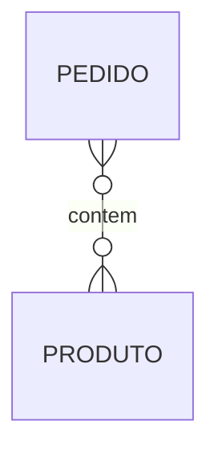
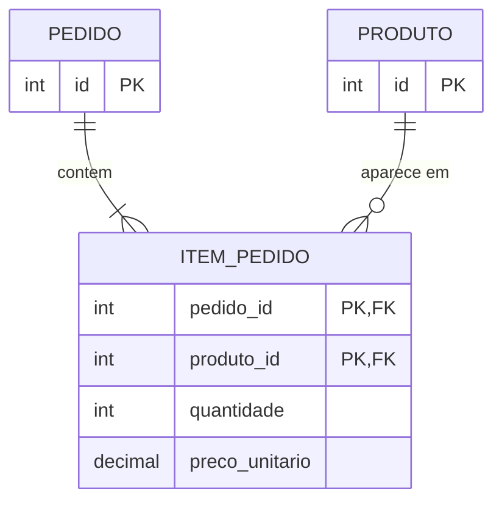
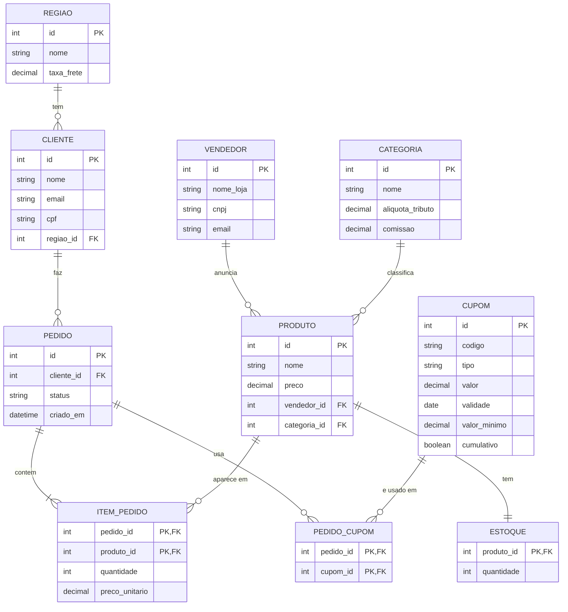

# 🗺️ Modelagem relacional + Cardinalidade e normalização

**Módulo 2 · Aula 1: do problema real ao modelo de dados**

Neste material você vai encontrar tudo o que vimos em aula, o exercício em dupla (em que você vai desenhar um **DER** e **normalizar** um modelo) e uma lista com 4 exercícios para praticar em casa.

> **Regra de ouro (a mesma de sempre):** faça um passo, confira, siga para o próximo. Um desenho feio e conferido vale mais do que um desenho perfeito que nunca saiu da cabeça. Se algo não bater, leia com calma: o erro é uma pista, não uma bronca.

---

## 📑 Sumário

1. [Como usar este material](#-como-usar-este-material)
2. [Vocabulário da aula](#-vocabulário-da-aula)
3. [O cenário: a planilha do MercadoÁgil](#o-cenário-a-planilha-do-mercadoágil)
4. [1. Entidades, atributos e relacionamentos](#1-entidades-atributos-e-relacionamentos)
5. [2. Do problema ao modelo](#2-do-problema-ao-modelo)
6. [3. Cardinalidade: 1:1, 1:N e N:N](#3-cardinalidade-11-1n-e-nn)
7. [4. Redundância e formas normais](#4-redundância-e-formas-normais)
8. [Resumo](#-resumo)
9. [Exercício da aula: o AgendaÁgil](#-exercício-da-aula-o-agendaágil)
10. [Lista de exercícios para casa](#-lista-de-exercícios-para-casa)
11. [Erros comuns e o que eles significam](#-erros-comuns-e-o-que-eles-significam)

---

## 💻 Como usar este material

1. Para desenhar, use o **Excalidraw** (excalidraw.com, não precisa de cadastro). O [guia rápido](#guia-rápido-do-excalidraw) está logo abaixo.
2. Os arquivos de código da aula estão na pasta `livecoding/`. Para rodar:

```bash
node livecoding/relacionamentos.js
node livecoding/redundancia.js
```

3. **Digite em vez de copiar e colar** sempre que for escrever as tabelas do seu modelo. Digitar ajuda a memorizar.
4. Os dois **entregáveis** da aula são: o **DER** (imagem do seu diagrama) e o **modelo normalizado** (as tabelas finais).

### Guia rápido do Excalidraw

- **Caixa de entidade:** retângulo (`R`) com o **NOME EM MAIÚSCULAS** no topo e um atributo por linha embaixo. Marque a chave primária como `🔑 id (PK)` e as estrangeiras como `regiao_id (FK → REGIAO)`.
- **Faça uma caixa e duplique:** `Ctrl/Cmd + D` copia a caixa. Só troque o texto.
- **Linha:** use a linha (`L`) ou a seta (`A`) sem pontas. Arraste de uma caixa até a outra: quando a ponta **gruda** na borda, a linha acompanha a caixa.
- **Em cada linha**, escreva um **verbo** no meio ("faz", "contém") e um **`1`** ou **`N`** perto de cada ponta.
- **Cores:** 🔵 entidade · 🟢 entidade nova (tabela associativa ou nascida da normalização) · 🔴 problema.
- **Guardar:** menu → **Exportar imagem** (PNG) para o entregável, e **Salvar em arquivo** para editar depois.

> **Checklist de um bom DER:** toda entidade tem PK · toda FK tem uma linha · nenhuma linha N:N direta · toda linha tem verbo e `1`/`N` nas duas pontas · dá para ler de longe.

---

## 📖 Vocabulário da aula

| Palavra | Significado simples |
|---|---|
| Entidade | Um **tipo de ficha** que existe no negócio (cliente, produto, pedido) |
| Atributo | Um **campo** da ficha (nome, preço, email) |
| Relacionamento | O **barbante** que liga duas fichas ("o cliente **faz** pedidos") |
| Chave primária (PK) | O **número da ficha** (`id`): não repete e não muda |
| Chave estrangeira (FK) | O `id` de **outra** ficha guardado aqui, para ligar as duas |
| Cardinalidade | **Quantos** de um lado se ligam a **quantos** do outro (1:1, 1:N, N:N) |
| Tabela associativa | A **terceira tabela** que resolve um N:N |
| DER | **Diagrama** Entidade-Relacionamento: o mapa do modelo |
| Redundância | A **mesma informação** escrita em mais de um lugar |
| Normalização | Arrumar as tabelas para **cada informação morar em um lugar só** |
| Forma normal (1FN, 2FN, 3FN) | Uma **regra** de arrumação, em três níveis |

---

## O cenário: a planilha do MercadoÁgil

No projeto final do M1, o MercadoÁgil registrava os pedidos **numa planilha**. Olhe um pedaço dela:

| pedido | cliente | email | região | taxa_frete | itens |
|---|---|---|---|---|---|
| 1 | Ana Souza | ana@email.com | Nordeste | 25 | 1x Mouse (R$ 120, eletronicos, comissão 8%); 1x Livro de JavaScript (R$ 80, livros, comissão 15%) |
| 2 | Bruno Lima | bruno@email.com | Sudeste | 20 | 2x Mouse (R$ 120, eletronicos, comissão 8%) |
| 3 | Ana Souza | ana@email.com | Nordeste | 25 | 1x Livro de JavaScript (R$ 80, livros, comissão 15%) |

**O que pode dar errado aqui?** Pense antes de seguir.

- Os dados da **Ana aparecem duas vezes**. Se ela mudar de email, quem muda nas duas linhas?
- A taxa do **Nordeste (25)** está escrita em todo pedido do Nordeste.
- A coluna `itens` tem **vários produtos num campo só**. Como contar quantos Mouses foram vendidos?

No M1 vocês guardaram tudo **em memória**, e quando o programa fecha, tudo some. Para guardar de verdade e sem bagunça, o primeiro passo é **modelar**: decidir que informações existem e como elas se ligam. Hoje desenhamos o mapa.

> **🎨 Em uma frase:** antes de guardar os dados, a gente desenha o mapa de como eles se ligam.

### 🌉 A ponte com o que você já sabe do M1

| No M1 (código) | No modelo de dados |
|---|---|
| Uma `class` (`Cliente`, `Produto`, `Pedido`) | **Entidade** |
| As propriedades do objeto (`nome`, `preco`) | **Atributos** |
| Um array de objetos | Uma **tabela** (cada objeto é uma linha) |
| O `id` do produto guardado no pedido, em vez de uma cópia | **Chave estrangeira (FK)**: referência, não cópia |
| O bug do apelido x cópia da Aula 2 | **Redundância**: a mesma informação copiada em vários lugares, que depois divergem |

---

## 1. Entidades, atributos e relacionamentos

**Por que usar?** Uma **entidade** é um **tipo de ficha** do negócio (a ficha de cliente, a de produto). Cada **atributo** é um campo da ficha. Um **relacionamento** é o **barbante** que liga duas fichas. A **chave primária** é o **número da ficha**: ninguém tem o mesmo.

| Conceito | Exemplo do MercadoÁgil | Parente do JS |
|---|---|---|
| Entidade | `CLIENTE`, `PRODUTO`, `PEDIDO` | A `class` |
| Atributo | `nome`, `email`, `preco` | A propriedade do objeto |
| Relacionamento | "o cliente **faz** pedidos" | Um objeto que guarda o `id` de outro |
| Chave primária (PK) | `id` | O `id` único de cada objeto |

### Por que a chave primária é um número (`id`)?

- O **nome repete**: dois clientes "Ana Souza".
- O **email muda**.
- O **CPF** é dado sensível (LGPD) e ficaria espalhado em tudo que ligasse ao cliente.
- Um `id` é só um número: **não significa nada** e **nunca muda**.

### Desenhando as duas primeiras entidades

```
  ┌────────────────────┐                        ┌─────────────────────────┐
  │ CLIENTE            │ 1        faz         N │ PEDIDO                  │
  │ 🔑 id (PK)         ├────────────────────────┤ 🔑 id (PK)              │
  │ nome               │                        │ status                  │
  │ email              │                        │ cliente_id (FK→CLIENTE) │
  └────────────────────┘                        └─────────────────────────┘
        ▲ entidade         ▲ atributo                    ▲ relacionamento
```

> **🎨 Em uma frase:** entidade é a ficha, atributo é o campo, relacionamento é o barbante.

**💬 E daí?** Se duas clientes se chamam "Ana Souza" e não existe um `id`, a loja cobra a Ana errada. A chave primária garante que cada cliente é **uma pessoa só** para o sistema.

**✅ Checkpoint:** dois clientes se chamam Ana Souza. Que coluna usamos para saber qual é qual? Por que não o nome?

<details>
<summary>💡 Ver resposta</summary>

O `id`. O nome pode se repetir, o email pode mudar e o CPF é sensível. O `id` é um número sem significado, único para cada cliente.

</details>

---

## 2. Do problema ao modelo

**Por que usar?** Modelar não é adivinhar. Existe um **método de 5 passos**, e o primeiro é só **ler com um marca-texto**.

| Passo | O que fazer | Pergunta-guia |
|---|---|---|
| 1. **Grifar** | Substantivos viram candidatas a **entidade**. Verbos viram **relacionamentos** | "O que existe? O que acontece entre as coisas?" |
| 2. **Separar** entidade de atributo | Se tem **dados próprios** e **vários**, é entidade. Se é só um valor, é atributo | "Isso tem campos? Existe sozinho?" |
| 3. **Escolher a PK** | Um `id` para cada entidade | "O que identifica cada uma sem repetir?" |
| 4. **Ligar** | Desenhar as linhas, com os verbos | "Quem se liga a quem?" |
| 5. **Conferir** com o negócio | Fazer perguntas de teste ao modelo | "Dá para responder: quanto o vendedor X vendeu?" |

### Aplicando ao MercadoÁgil

Leia o texto e grife substantivos (**negrito**) e verbos:

> O MercadoÁgil é um marketplace onde **vários vendedores** anunciam **produtos** e **vários clientes** compram. Uma compra pode ter **itens** de vendedores diferentes. Cada produto pertence a uma **categoria**. O cliente mora numa **região** de entrega. A equipe aplica **cupons** nos pedidos e precisa controlar o **estoque** de cada produto.

| Candidata | Decisão | Por quê |
|---|---|---|
| Vendedor, Cliente, Produto, Pedido | **Entidade** | Têm dados próprios e vários |
| Item (do pedido) | **Entidade** (fica para a seção 3) | Cada item tem quantidade e preço |
| Categoria, Região | **Atributo por enquanto** (voltam na seção 4) | Primeiro desenhamos o núcleo |
| Cupom | **Entidade** | Tem código, tipo, valor, validade... |
| Estoque | **Entidade ou atributo** (discordância!) | Veja abaixo |

**🗣️ Discordância Positiva:** "Estoque é uma entidade ou só um atributo `quantidade` do Produto?" Os dois lados valem. Defenda o seu com **um argumento**. Se existir só a quantidade, um atributo é mais simples. Se o estoque tiver dados próprios (depósito, quantidade mínima), vira entidade. Hoje vamos tratá-lo como entidade, para treinar o 1:1.

### O núcleo do modelo (etapa 1)

```
 ┌─────────┐  faz  ┌─────────┐ ┄ contém ┄ ┌─────────┐ anuncia ┌──────────┐
 │ CLIENTE ├───────┤ PEDIDO  ├┄┄┄┄┄┄┄┄┄┄┄┤ PRODUTO ├─────────┤ VENDEDOR │
 └─────────┘       └─────────┘            └─────────┘         └──────────┘
```

A linha tracejada entre Pedido e Produto ainda não está resolvida. Guarde essa dúvida: a seção 3 resolve.

> **🎨 Em uma frase:** primeiro o núcleo. Os detalhes entram depois, um de cada vez.

**💬 E daí?** Um modelo errado custa caro **depois**. Mudar a estrutura de um sistema com milhões de pedidos dá muito mais trabalho do que apagar uma caixa num desenho de 10 minutos.

**✅ Checkpoint:** o Cupom é uma entidade ou um atributo do Pedido? Por quê?

<details>
<summary>💡 Ver resposta</summary>

**Entidade.** O cupom tem seus próprios dados (código, tipo, valor, validade, valor mínimo, se é cumulativo) e **existe antes** de qualquer pedido. Um atributo é um fato simples sobre uma entidade.

</details>

---

## 3. Cardinalidade: 1:1, 1:N e N:N

**Por que usar?** A **cardinalidade** diz **quantos** de um lado se ligam a **quantos** do outro. Existe uma **regra das duas perguntas**:

> **1. Um A tem quantos B? 2. Um B tem quantos A?**

| Respostas | Cardinalidade | Exemplo do MercadoÁgil |
|---|---|---|
| um e um | **1:1** | **Produto** e **Estoque**: cada produto tem um registro de estoque, e cada registro é de um produto |
| um e muitos | **1:N** | **Vendedor** e **Produto**: um vendedor anuncia vários produtos, e cada produto é de um vendedor |
| muitos e muitos | **N:N** | **Pedido** e **Produto**: um pedido tem vários produtos, e um produto aparece em vários pedidos |

### A regra da chave estrangeira

> **Quem tem "muitos" guarda o `id` de quem tem "um".**

O produto guarda o `vendedor_id`, nunca o contrário. É o mesmo princípio do M1: guardar o **id em vez de uma cópia** (o apelido x cópia da Aula 2).

### O N:N nunca fica direto

Ele vira uma **terceira tabela**, a **tabela associativa**, com duas FKs. Os dados do "encontro" moram nela. No `ITEM_PEDIDO` ficam a `quantidade` e o `preco_unitario`:



vira:



> **Por que não uma lista de ids numa célula (`produtos: "1, 2"`)?** Porque fica impossível contar, buscar e ligar. É o problema da 1ª forma normal, que vemos na seção 4.

### Vendo as ligações no código

O arquivo `livecoding/relacionamentos.js` mostra que cada "tabela" é um array de objetos e que a ligação é feita **por id**:

```js
// Cada "tabela" é um array de objetos. A ligação entre elas é feita por id.
const regioes = [
  { id: 1, nome: 'Nordeste', taxaFrete: 25 },
  { id: 2, nome: 'Sudeste', taxaFrete: 20 },
];
const clientes = [
  { id: 1, nome: 'Ana Souza', email: 'ana@email.com', regiaoId: 1 },
  { id: 2, nome: 'Bruno Lima', email: 'bruno@email.com', regiaoId: 2 },
];
const vendedores = [
  { id: 1, nomeLoja: 'TechBahia' },
  { id: 2, nomeLoja: 'Livraria Sol' },
];
const categorias = [
  { id: 1, nome: 'eletronicos', comissao: 8 },
  { id: 2, nome: 'livros', comissao: 15 },
];
const produtos = [
  { id: 1, nome: 'Mouse', preco: 120, vendedorId: 1, categoriaId: 1 },
  { id: 2, nome: 'Livro de JavaScript', preco: 80, vendedorId: 2, categoriaId: 2 },
];
const estoque = [
  { produtoId: 1, quantidade: 10 },
  { produtoId: 2, quantidade: 4 },
];
const pedidos = [
  { id: 1, clienteId: 1 },
  { id: 2, clienteId: 2 },
  { id: 3, clienteId: 1 },
];
const itensPedido = [
  { pedidoId: 1, produtoId: 1, quantidade: 1, precoUnitario: 120 },
  { pedidoId: 1, produtoId: 2, quantidade: 1, precoUnitario: 80 },
  { pedidoId: 2, produtoId: 1, quantidade: 2, precoUnitario: 120 },
  { pedidoId: 3, produtoId: 2, quantidade: 1, precoUnitario: 80 },
];

// 1:N e 1:1 - o produto guarda só os ids; montamos a ficha completa buscando cada um
function montarProduto(idDoProduto) {
  const produto = produtos.find(p => p.id === idDoProduto);
  const vendedor = vendedores.find(v => v.id === produto.vendedorId);
  const categoria = categorias.find(c => c.id === produto.categoriaId);
  const saldo = estoque.find(e => e.produtoId === produto.id);
  return {
    nome: produto.nome,
    preco: produto.preco,
    vendedor: vendedor.nomeLoja,
    categoria: categoria.nome,
    estoque: saldo.quantidade,
  };
}

// N:N - o pedido e os produtos se encontram na tabela itensPedido
function montarPedido(idDoPedido) {
  const pedido = pedidos.find(p => p.id === idDoPedido);
  const cliente = clientes.find(c => c.id === pedido.clienteId);
  const regiao = regioes.find(r => r.id === cliente.regiaoId);
  const itens = itensPedido.filter(i => i.pedidoId === idDoPedido);
  const subtotal = itens.reduce((soma, i) => soma + i.quantidade * i.precoUnitario, 0);
  return {
    id: pedido.id,
    cliente: cliente.nome,
    regiao: regiao.nome,
    frete: regiao.taxaFrete,
    quantidadeDeItens: itens.length,
    subtotal,
  };
}

console.log(montarProduto(1));
console.log(montarPedido(1));
console.log(montarPedido(2));

// N:N visto do outro lado: em quais pedidos o Mouse aparece?
const mouse = produtos.find(p => p.nome === 'Mouse');
const pedidosComMouse = itensPedido
  .filter(item => item.produtoId === mouse.id)
  .map(item => item.pedidoId);
console.log(pedidosComMouse);

// O preço do Mouse sobe, mas o pedido antigo continua com o preço da época
const produtosReajustados = produtos.map(p => (p.id === 1 ? { ...p, preco: 130 } : p));
console.log(produtosReajustados[0].preco, montarPedido(1).subtotal);
```

Resultado esperado no terminal (`node livecoding/relacionamentos.js`):

```
{
  nome: 'Mouse',
  preco: 120,
  vendedor: 'TechBahia',
  categoria: 'eletronicos',
  estoque: 10
}
{
  id: 1,
  cliente: 'Ana Souza',
  regiao: 'Nordeste',
  frete: 25,
  quantidadeDeItens: 2,
  subtotal: 200
}
{
  id: 2,
  cliente: 'Bruno Lima',
  regiao: 'Sudeste',
  frete: 20,
  quantidadeDeItens: 1,
  subtotal: 240
}
[ 1, 2 ]
130 200
```

- `montarProduto` segue o `vendedorId`, o `categoriaId` e o estoque (**1:N e 1:1**).
- `montarPedido` mostra que o pedido e os produtos só se encontram na tabela `itensPedido` (**N:N**).
- `[ 1, 2 ]`: o Mouse aparece nos pedidos 1 e 2 (o N:N visto do outro lado).
- `130 200`: o Mouse subiu de preço, e o **pedido antigo manteve o preço da época**.

### O modelo com as cardinalidades (etapa 2)

```
 CLIENTE ─1──N─ PEDIDO ─1──N─ ITEM_PEDIDO ─N──1─ PRODUTO ─N──1─ VENDEDOR
                   │ 1                              │ 1
                   │ N                              │ 1
             PEDIDO_CUPOM ─N──1─ CUPOM           ESTOQUE
```

> **🎨 Em uma frase:** quem tem "muitos" guarda o id de quem tem "um". Todo N:N vira uma terceira tabela.

**💬 E daí?** Se o N:N ficasse direto (ou numa lista dentro de uma célula), a loja não saberia quantas unidades de um produto vendeu nem daria baixa no estoque certo. É dinheiro perdido e cliente insatisfeito.

**✅ Checkpoint:** uma cliente pode cadastrar vários endereços de entrega, e cada endereço é de uma cliente só. Qual a cardinalidade? Onde vai a FK?

<details>
<summary>💡 Ver resposta</summary>

**1:N.** Quem tem "muitos" é o **endereço**, então a FK `cliente_id` fica na tabela `ENDERECO`.

</details>

---

## 4. Redundância e formas normais

**Por que usar?** **Normalizar** é arrumar as tabelas para que **cada informação more em um lugar só**. É como o endereço da cliente: fica **uma vez no cadastro**, e não escrito em cada carta que a loja manda. Uma frase para guardar:

> **"A chave, a chave inteira e nada além da chave."**

### Primeiro, o problema

O arquivo `livecoding/redundancia.js` usa a planilha com **uma linha por item** e mostra o que dá errado quando o mesmo dado está em vários lugares:

```js
// A planilha do MercadoÁgil: uma linha por item vendido
const planilha = [
  { pedido: 1, cliente: 'Ana Souza', email: 'ana@email.com', regiao: 'Nordeste', taxaFrete: 25, produto: 'Mouse', quantidade: 1 },
  { pedido: 1, cliente: 'Ana Souza', email: 'ana@email.com', regiao: 'Nordeste', taxaFrete: 25, produto: 'Livro de JavaScript', quantidade: 1 },
  { pedido: 2, cliente: 'Bruno Lima', email: 'bruno@email.com', regiao: 'Sudeste', taxaFrete: 20, produto: 'Mouse', quantidade: 2 },
  { pedido: 3, cliente: 'Ana Souza', email: 'ana@email.com', regiao: 'Nordeste', taxaFrete: 25, produto: 'Livro de JavaScript', quantidade: 1 },
];

// Problema 1: a Ana mudou de email. A atendente corrige só as linhas do pedido 1...
const atualizada = planilha.map(linha =>
  linha.pedido === 1 ? { ...linha, email: 'ana.souza@novo.com' } : linha
);
const emailsDaAna = atualizada
  .filter(linha => linha.cliente === 'Ana Souza')
  .map(linha => linha.email);
console.log(emailsDaAna);

// Problema 2: o pedido 2 foi apagado. O Bruno some junto?
const semPedido2 = planilha.filter(linha => linha.pedido !== 2);
console.log(semPedido2.find(linha => linha.cliente === 'Bruno Lima'));

// Solução: cada informação mora em UM lugar só
const clientes = [
  { id: 1, nome: 'Ana Souza', email: 'ana@email.com' },
  { id: 2, nome: 'Bruno Lima', email: 'bruno@email.com' },
];
const pedidos = [
  { id: 1, clienteId: 1 },
  { id: 2, clienteId: 2 },
  { id: 3, clienteId: 1 },
];

// A Ana muda de email: UMA mudança só
const clientesAtualizados = clientes.map(cliente =>
  cliente.id === 1 ? { ...cliente, email: 'ana.souza@novo.com' } : cliente
);
const pedido3 = pedidos.find(pedido => pedido.id === 3);
const donoDoPedido3 = clientesAtualizados.find(cliente => cliente.id === pedido3.clienteId);
console.log(donoDoPedido3.email);

// O pedido 2 é apagado: o Bruno continua existindo
const pedidosSemODois = pedidos.filter(pedido => pedido.id !== 2);
console.log(pedidosSemODois.length, clientes.find(cliente => cliente.nome === 'Bruno Lima').nome);
```

Resultado esperado no terminal (`node livecoding/redundancia.js`):

```
[ 'ana.souza@novo.com', 'ana.souza@novo.com', 'ana@email.com' ]
undefined
ana.souza@novo.com
2 Bruno Lima
```

1. `[ 'ana.souza@novo.com', 'ana.souza@novo.com', 'ana@email.com' ]`: a Ana tem **dois emails** na planilha, porque a atendente esqueceu uma linha.
2. `undefined`: ao apagar o pedido 2, o **Bruno desapareceu**, porque ele só existia dentro do pedido.
3. `ana.souza@novo.com`: com os clientes numa tabela só, **uma mudança** vale para todos os pedidos da Ana.
4. `2 Bruno Lima`: apagando o pedido 2, o Bruno **continua** existindo.

Esses problemas têm nome: **anomalias**.

| Anomalia | O que acontece | Exemplo |
|---|---|---|
| **Atualização** | Mudar um dado em um lugar e esquecer de outros | A Ana com dois emails |
| **Exclusão** | Apagar uma informação e perder outra junto | O Bruno some com o pedido |
| **Inserção** | Não conseguir cadastrar algo sem outra coisa | Cliente novo sem pedido |

### As três formas normais

Vamos arrumar a planilha do MercadoÁgil em três passos. Em cada um, responda à **pergunta-teste** antes de olhar a solução.

**Ponto de partida:**

| pedido | cliente | email | região | taxa_frete | itens |
|---|---|---|---|---|---|
| 1 | Ana Souza | ana@email.com | Nordeste | 25 | 1x Mouse (R$ 120, eletronicos, comissão 8%); 1x Livro de JavaScript (R$ 80, livros, comissão 15%) |
| 2 | Bruno Lima | bruno@email.com | Sudeste | 20 | 2x Mouse (R$ 120, eletronicos, comissão 8%) |
| 3 | Ana Souza | ana@email.com | Nordeste | 25 | 1x Livro de JavaScript (R$ 80, livros, comissão 15%) |

#### 1ª Forma Normal (1FN): "um valor por célula"

**Pergunta-teste:** tem uma lista dentro de alguma célula?

**Problema:** a coluna `itens` tem vários produtos num campo só.

**Solução:** **uma linha por item**. A chave passa a ser **(pedido, produto)**.

| pedido | produto | quantidade | preco | categoria | comissao | cliente | email | regiao | taxa_frete |
|---|---|---|---|---|---|---|---|---|---|
| 1 | Mouse | 1 | 120 | eletronicos | 8 | Ana Souza | ana@email.com | Nordeste | 25 |
| 1 | Livro de JavaScript | 1 | 80 | livros | 15 | Ana Souza | ana@email.com | Nordeste | 25 |
| 2 | Mouse | 2 | 120 | eletronicos | 8 | Bruno Lima | bruno@email.com | Sudeste | 20 |
| 3 | Livro de JavaScript | 1 | 80 | livros | 15 | Ana Souza | ana@email.com | Nordeste | 25 |

#### 2ª Forma Normal (2FN): "a chave inteira"

**Pergunta-teste:** esta coluna depende da **chave inteira** (pedido **e** produto) ou só de **uma parte**?

**Problema:** `cliente`, `email`, `regiao` e `taxa_frete` dependem **só do pedido**. `preco`, `categoria` e `comissao` dependem **só do produto**. Só a `quantidade` depende dos dois.

**Solução:** separar em três tabelas.

`PEDIDO`

| pedido | cliente | email | regiao | taxa_frete |
|---|---|---|---|---|
| 1 | Ana Souza | ana@email.com | Nordeste | 25 |
| 2 | Bruno Lima | bruno@email.com | Sudeste | 20 |
| 3 | Ana Souza | ana@email.com | Nordeste | 25 |

`PRODUTO`

| produto | preco | categoria | comissao |
|---|---|---|---|
| Mouse | 120 | eletronicos | 8 |
| Livro de JavaScript | 80 | livros | 15 |

`ITEM_PEDIDO`

| pedido | produto | quantidade |
|---|---|---|
| 1 | Mouse | 1 |
| 1 | Livro de JavaScript | 1 |
| 2 | Mouse | 2 |
| 3 | Livro de JavaScript | 1 |

Ainda sobrou redundância: a **Ana aparece duas vezes** em `PEDIDO`.

#### 3ª Forma Normal (3FN): "nada além da chave"

**Pergunta-teste:** alguma coluna depende de **outra coluna que não é a chave**?

**Problema:** em `PEDIDO`, o `email` e a `regiao` dependem do **cliente** (e não do pedido), e a `taxa_frete` depende da **região**. Em `PRODUTO`, a `comissao` depende da **categoria**.

**Solução:** cada dependência vira **uma tabela própria**, e passamos a usar `id` como chave.

`CLIENTE`

| id | nome | email | regiao_id |
|---|---|---|---|
| 1 | Ana Souza | ana@email.com | 1 |
| 2 | Bruno Lima | bruno@email.com | 2 |

`REGIAO`

| id | nome | taxa_frete |
|---|---|---|
| 1 | Nordeste | 25 |
| 2 | Sudeste | 20 |

`PEDIDO`

| id | cliente_id |
|---|---|
| 1 | 1 |
| 2 | 2 |
| 3 | 1 |

`CATEGORIA`

| id | nome | comissao |
|---|---|---|
| 1 | eletronicos | 8 |
| 2 | livros | 15 |

`PRODUTO`

| id | nome | preco | categoria_id |
|---|---|---|---|
| 1 | Mouse | 120 | 1 |
| 2 | Livro de JavaScript | 80 | 2 |

`ITEM_PEDIDO`

| pedido_id | produto_id | quantidade |
|---|---|---|
| 1 | 1 | 1 |
| 1 | 2 | 1 |
| 2 | 1 | 2 |
| 3 | 2 | 1 |

Volte ao `redundancia.js` e ao `relacionamentos.js`: **os arrays do código são exatamente estas tabelas**. A **Região** e a **Categoria** nasceram da normalização.

### A exceção que dá o que pensar: o preço da época

No `relacionamentos.js`, o item guarda um `precoUnitario`, e o produto **também** tem `preco`. Isso **não** é redundância: é o **preço da época da compra**, um fato histórico. Se o Mouse subir para R$ 130 amanhã, o pedido de ontem **não pode mudar**.

> **Normalizar não é separar tudo.** É não repetir informação que **muda junto**. O preço da época **não muda junto** com o preço atual.

**🗣️ Discordância Positiva:** quem acha que o `preco_unitario` deveria ser apagado do item? Por quê? E o que quebra?

### O DER final do MercadoÁgil (etapa 3)

O mesmo diagrama, em texto (o GitHub desenha para você):



> **🎨 Em uma frase:** cada informação mora em um lugar só.

**💬 E daí?** Taxas e comissões mudam. Se estiverem espalhadas por toda parte, uma mudança vira uma caça ao dado esquecido, e a loja cobra ou repassa o valor errado.

**✅ Checkpoint:** a Região e a Categoria não existiam no começo. De onde elas vieram?

<details>
<summary>💡 Ver resposta</summary>

Da **3ª forma normal**. A `taxa_frete` dependia da região (e não do cliente), e a `comissao` dependia da categoria (e não do produto). Cada uma virou sua própria tabela.

</details>

---

## 🧠 Resumo

| Quero... | Uso |
|---|---|
| Descobrir as entidades de um texto | Grifar substantivos (entidades) e verbos (relacionamentos) |
| Identificar cada linha de uma tabela | **PK**: um `id` |
| Ligar duas entidades | **FK**: o lado "muitos" guarda o `id` do lado "um" |
| Saber a cardinalidade | As duas perguntas: "um A tem quantos B? um B tem quantos A?" |
| Resolver um N:N | **Tabela associativa** com duas FKs (e os dados do "encontro") |
| Evitar lista dentro de uma célula | **1FN**: uma linha por item |
| Evitar dado que depende de só parte da chave | **2FN**: "a chave inteira" |
| Evitar dado que depende de outra coluna | **3FN**: "nada além da chave" |
| Guardar o preço da época | Um campo no item (`preco_unitario`) |

| Forma normal | Pergunta-teste | Frase |
|---|---|---|
| **1FN** | Tem uma lista dentro de uma célula? | Um valor por célula |
| **2FN** | Depende da chave **inteira** ou só de uma parte? | A chave inteira |
| **3FN** | Depende de **outra coluna** que não é a chave? | Nada além da chave |

---

## 👥 Exercício da aula: o AgendaÁgil

**Tempo:** até 45 minutos. Faça em dupla: uma pessoa é a **pilota** (desenha e digita) e a outra é a **navegadora** (lê o enunciado e confere). **Troquem de papel a cada passo.**

### 🎯 O cenário

A barbearia do Seu Léo cresceu e agora precisa organizar os agendamentos, que ainda ficam numa planilha. Você vai **desenhar o DER** e **normalizar o modelo**.

> A barbearia do Seu Léo cresceu e agora tem **duas unidades**. Cada unidade tem um nome e um endereço. Cada **profissional** trabalha em uma única unidade. Os **clientes** agendam pelo WhatsApp: um cliente pode fazer vários **agendamentos**, e cada agendamento tem data, hora e um profissional. Em um mesmo agendamento o cliente pode contratar mais de um **serviço** (corte, barba, sobrancelha). Cada serviço tem um nome, um preço de tabela e uma duração. O preço de tabela pode mudar, mas o cliente sempre paga o preço que estava valendo **no dia do agendamento**.

A planilha atual:

| agendamento | data | hora | cliente | telefone | profissional | unidade | endereco_unidade | servicos | precos | duracoes |
|---|---|---|---|---|---|---|---|---|---|---|
| 1 | 2026-11-10 | 14:00 | Marina Alves | (71) 99999-0001 | Léo | Centro | Rua A, 10 | Corte, Barba | 40, 25 | 30, 20 |
| 2 | 2026-11-10 | 15:00 | Diego Costa | (71) 99999-0002 | Bia | Orla | Av. B, 200 | Corte | 40 | 30 |
| 3 | 2026-11-12 | 10:00 | Marina Alves | (71) 99999-0001 | Léo | Centro | Rua A, 10 | Sobrancelha | 15 | 15 |

### 📦 O que a dupla entrega

1. O **DER** em imagem (PNG exportado do Excalidraw) ou o link.
2. Um arquivo `modelo-normalizado.md` com as tabelas finais, neste esqueleto:

```markdown
# Modelo normalizado: AgendaÁgil

## UNIDADE
- id (PK)
- ...

## PROFISSIONAL
- id (PK)
- ...
```

### 🧭 Como a dupla trabalha (High Agency na prática)

- **Bias to Action:** faça um **rascunho** de DER logo no começo e corrija conforme avança. Não espere a resposta perfeita.
- **Clear Thinking:** antes de criar uma entidade ou um campo, responda em voz alta: **"quem vai usar essa informação e para quê?"**
- **Discordância Positiva:** em pelo menos **2 passos**, a navegadora propõe **outra forma** de modelar. A dupla testa as duas e escolhe com argumento, **não** quem fala mais alto.

### 🪜 Os passos

Confira o **resultado esperado** de cada passo antes de seguir.

**Passo 1 (4 min): Grifar.** Leia o texto do cenário. Grife os **substantivos** (candidatas a entidade) e os **verbos** (relacionamentos). Anote as duas listas.
> Resultado esperado: **5 entidades** candidatas (unidade, profissional, cliente, agendamento, serviço) e **4 relacionamentos** ("tem", "faz", "atende", "contrata"/"tem serviços"). Endereço, preço, duração, data, hora e telefone **não** são entidades: são campos.

**Passo 2 (6 min): Atributos e chave primária.** Para cada entidade, liste os atributos e escolha a **PK** (um `id`). Ainda **não** coloque as chaves estrangeiras.
> Resultado esperado:
> - `UNIDADE`: id, nome, endereco
> - `PROFISSIONAL`: id, nome
> - `CLIENTE`: id, nome, telefone
> - `SERVICO`: id, nome, preco, duracao_min
> - `AGENDAMENTO`: id, data, hora

**Passo 3 (6 min): Cardinalidades.** Para cada par ligado, faça as duas perguntas ("um A tem quantos B? um B tem quantos A?"). Diga a cardinalidade e **onde fica a FK** (ou qual **tabela associativa** é preciso criar).
> Resultado esperado:
>
> | Relação | Um A tem quantos B? | Um B tem quantos A? | Cardinalidade | FK ou tabela |
> |---|---|---|---|---|
> | Unidade e Profissional | muitos | um | **1:N** | `PROFISSIONAL.unidade_id` |
> | Cliente e Agendamento | muitos | um | **1:N** | `AGENDAMENTO.cliente_id` |
> | Profissional e Agendamento | muitos | um | **1:N** | `AGENDAMENTO.profissional_id` |
> | Agendamento e Serviço | muitos | muitos | **N:N** | tabela **`ITEM_AGENDAMENTO`** |

**Passo 4 (10 min): O DER no Excalidraw.** Desenhe o diagrama com as entidades, as linhas (com verbo e `1`/`N`), as FKs e a tabela associativa em **verde**. Use o guia rápido e o checklist de um bom DER.
> Resultado esperado: **6 caixas** (as 5 entidades + `ITEM_AGENDAMENTO`), **5 linhas**, cada linha com verbo e `1`/`N` nas duas pontas, PK e FK marcadas, **nenhuma linha N:N direta**. O `ITEM_AGENDAMENTO` guarda **o preço cobrado** (lembre da regra do preço do dia).

**Passo 5 (5 min): 1ª forma normal.** Na planilha, a coluna `servicos` tem uma lista dentro de cada célula. Reescreva a planilha com **uma linha por serviço**.
> Resultado esperado: a planilha passa a ter **4 linhas** (o agendamento 1 vira 2 linhas), e a chave passa a ser **(agendamento, servico)**:
>
> | agendamento | data | hora | cliente | telefone | profissional | unidade | endereco_unidade | servico | preco | duracao |
> |---|---|---|---|---|---|---|---|---|---|---|
> | 1 | 2026-11-10 | 14:00 | Marina Alves | (71) 99999-0001 | Léo | Centro | Rua A, 10 | Corte | 40 | 30 |
> | 1 | 2026-11-10 | 14:00 | Marina Alves | (71) 99999-0001 | Léo | Centro | Rua A, 10 | Barba | 25 | 20 |
> | 2 | 2026-11-10 | 15:00 | Diego Costa | (71) 99999-0002 | Bia | Orla | Av. B, 200 | Corte | 40 | 30 |
> | 3 | 2026-11-12 | 10:00 | Marina Alves | (71) 99999-0001 | Léo | Centro | Rua A, 10 | Sobrancelha | 15 | 15 |

**Passo 6 (5 min): 2ª forma normal.** Com a chave **(agendamento, servico)**, quais colunas dependem **só de uma parte** da chave? Separe em tabelas.
> Resultado esperado: **3 tabelas** (colunas):
> - `AGENDAMENTO`: agendamento, data, hora, cliente, telefone, profissional, unidade, endereco_unidade (dependem **só do agendamento**)
> - `SERVICO`: servico, duracao e o **preço de tabela** (dependem **só do serviço**)
> - `ITEM_AGENDAMENTO`: agendamento, servico, **preco_cobrado** (o preço do dia depende **dos dois**)

**Passo 7 (5 min): 3ª forma normal.** Na tabela `AGENDAMENTO`, alguma coluna depende de **outra coluna que não é a chave**? Separe, e passe a usar `id` como chave.
> Resultado esperado: **6 tabelas finais**:
> - `UNIDADE` (id, nome, endereco)
> - `PROFISSIONAL` (id, nome, unidade_id)
> - `CLIENTE` (id, nome, telefone)
> - `SERVICO` (id, nome, preco, duracao_min)
> - `AGENDAMENTO` (id, data, hora, cliente_id, profissional_id)
> - `ITEM_AGENDAMENTO` (agendamento_id, servico_id, preco_cobrado)
>
> As dependências: o `telefone` depende do **cliente**; o `endereco` depende da **unidade**, que depende do **profissional**.

**Passo 8 (3 min): Conferir.** Responda, olhando para o seu modelo:
1. A Marina mudou de telefone. Em **quantos lugares** você muda?
2. O endereço da unidade Centro mudou. Em **quantos lugares** você muda?
3. O corte subiu para R$ 45. O agendamento do dia 10 **muda de valor**?
> Resultado esperado: **1 lugar** (`CLIENTE`); **1 lugar** (`UNIDADE`); **não muda**, porque o `preco_cobrado` guarda o preço do dia.

**🚀 Desafio extra: nem todo profissional faz todo serviço.** Um profissional pode fazer vários serviços e um serviço pode ser feito por vários profissionais.
1. Qual é a cardinalidade? Falta alguma tabela no seu DER?
2. **Discordância Positiva:** o `ITEM_AGENDAMENTO` deveria impedir que um serviço seja marcado com um profissional que **não** o faz? Defendam um lado com **um argumento**.

**Pergunta para responder em dupla** (num comentário no topo do `modelo-normalizado.md`): por que o `preco_cobrado` fica no item, se o serviço **já tem** um preço? Escrevam **uma frase pensando na barbearia** e **uma pensando na cliente**.

### ✅ Antes de entregar

- [ ] O DER passa no **checklist de um bom DER**?
- [ ] As **6 tabelas finais** estão no `modelo-normalizado.md`, com PK e FK?
- [ ] A dupla trocou de papel a cada passo?
- [ ] Alguém na dupla consegue explicar, **com as próprias palavras**, a diferença entre 2FN e 3FN?
- [ ] A dupla discordou de forma positiva em pelo menos 2 passos?

---

## 📝 Lista de exercícios para casa

Faça cada um **sozinho(a)**, nesta ordem. Os exercícios são de **modelagem**: dá para fazer no papel, no Excalidraw ou num arquivo de texto. **Um passo de cada vez**: faça, confira, siga.

As dicas estão escondidas: clique em **"💡 Ver dicas"** só depois de tentar. Tentar primeiro, mesmo errando, é o que faz você aprender.

| Exercício | Tema | Dificuldade |
|---|---|---|
| 1. Substantivos e verbos | Entidades, atributos e relacionamentos de um texto | 🟢 Fácil |
| 2. Qual é a cardinalidade? | 1:1, 1:N, N:N, FK e tabela associativa | 🟡 Médio |
| 3. Qual forma normal foi quebrada? | 1FN, 2FN e 3FN | 🟢 Fácil |
| 4. Do zero ao DER: o BikeÁgil | Tudo junto: DER e modelo normalizado | 🔴 Difícil |

---

### Exercício 1: Substantivos e verbos 🟢 Fácil

A biblioteca do bairro empresta livros. Leia o texto e grife substantivos e verbos.

> A biblioteca do bairro empresta livros. Cada **livro** tem título, ISBN e ano. Um livro pode ter vários **exemplares** físicos, e cada exemplar tem uma etiqueta e um estado (novo, usado, danificado). Os **leitores** se cadastram com nome, CPF e telefone. Um leitor pode pegar vários exemplares **emprestados**, e cada empréstimo registra a data de retirada e a data prevista de devolução.

**O que fazer:**

1. Liste as **entidades** (substantivos que têm dados próprios).
2. Liste os **relacionamentos** (os verbos que ligam as entidades).
3. Para cada entidade, liste **3 atributos** (ou mais).
4. Escreva um comentário: **"o empréstimo é uma entidade ou só uma ligação? Por quê?"**

**Resultado esperado:**

- Entidades: **Livro, Exemplar, Leitor e Empréstimo** (4).
- Relacionamentos: livro **tem** exemplares; leitor **pega** exemplar emprestado.
- Atributos: cada entidade com os campos do texto (ex.: Livro: título, ISBN, ano).

<details>
<summary>💡 Ver dicas</summary>

- Substantivos com dados próprios (que têm campos) são candidatos a entidade. `título` é só um campo do livro.
- "Livro" e "exemplar" são **coisas diferentes**: o livro é a obra; o exemplar é a cópia física que alguém segura.
- Para o item 4, pergunte: "o empréstimo tem dados próprios (datas)?"
- Lembre do método dos 5 passos da seção 2.

</details>

---

### Exercício 2: Qual é a cardinalidade? 🟡 Médio

Para cada situação, use a **regra das duas perguntas** e preencha a tabela. Para N:N, diga o **nome da tabela associativa** e **um atributo** que mora nela. Para 1:1 e 1:N, diga **em qual tabela fica a FK**.

| Situação | Um A tem quantos B? | Um B tem quantos A? | Cardinalidade | FK ou tabela associativa |
|---|---|---|---|---|
| a) Cliente e Pedido | ? | ? | ? | ? |
| b) Pedido e Produto | ? | ? | ? | ? |
| c) Produto e Estoque | ? | ? | ? | ? |
| d) Vendedor e Produto | ? | ? | ? | ? |
| e) Pedido e Cupom (até 2 cupons por pedido) | ? | ? | ? | ? |
| f) Leitor e Exemplar (biblioteca do Exercício 1) | ? | ? | ? | ? |

**Resultado esperado:**

| Situação | Cardinalidade | FK ou tabela associativa |
|---|---|---|
| a) Cliente e Pedido | **1:N** | `cliente_id` em `PEDIDO` |
| b) Pedido e Produto | **N:N** | `ITEM_PEDIDO` (ex.: `quantidade`) |
| c) Produto e Estoque | **1:1** | `produto_id` em `ESTOQUE` |
| d) Vendedor e Produto | **1:N** | `vendedor_id` em `PRODUTO` |
| e) Pedido e Cupom | **N:N** | `PEDIDO_CUPOM` |
| f) Leitor e Exemplar | **N:N** | `EMPRESTIMO` (ex.: `retirada`) |

<details>
<summary>💡 Ver dicas</summary>

- Faça **as duas perguntas**, uma de cada lado. A resposta "muitos" aparece quando a pergunta vale para vários.
- 1:N: a FK fica no lado do **"muitos"**.
- N:N: nunca fica direto. Crie uma **terceira tabela** com **duas FKs** e ponha nela os dados do "encontro".
- Na letra **e**, pense: um cupom pode ser usado em vários pedidos? E um pedido pode ter mais de um cupom?
- Na letra **f**, pense **ao longo do tempo**: o mesmo exemplar é emprestado a vários leitores (um de cada vez).
- Se estiver na dúvida entre 1:1 e 1:N, pergunte: "o outro lado pode ter **mais de um**?"

</details>

---

### Exercício 3: Qual forma normal foi quebrada? 🟢 Fácil

Cada tabela abaixo quebra **uma** forma normal. Para cada uma, diga **qual** (1FN, 2FN ou 3FN), **por quê** (uma frase) e **reescreva** as tabelas já corrigidas.

**Tabela A: `contato`**

| id | nome | telefones |
|---|---|---|
| 1 | Ana | 7199-1111, 7198-2222 |
| 2 | Bruno | 7197-3333 |

**Tabela B: `item_pedido`** (chave composta: `pedido_id` + `produto_id`)

| pedido_id | produto_id | nome_produto | quantidade |
|---|---|---|---|
| 1 | 10 | Mouse | 1 |
| 1 | 20 | Livro | 2 |
| 2 | 10 | Mouse | 3 |

**Tabela C: `produto`**

| id | nome | categoria | comissao |
|---|---|---|---|
| 10 | Mouse | eletronicos | 8 |
| 20 | Livro | livros | 15 |
| 30 | Teclado | eletronicos | 8 |

**Resultado esperado:**

- **A: 1FN.** A coluna `telefones` tem uma lista numa célula. Fica `CONTATO` (id, nome) e `TELEFONE` (id, contato_id, numero).
- **B: 2FN.** O `nome_produto` depende só do `produto_id` (parte da chave). Fica `PRODUTO` (id, nome) e `ITEM_PEDIDO` (pedido_id, produto_id, quantidade).
- **C: 3FN.** A `comissao` depende da `categoria` (outra coluna, não da chave). Fica `CATEGORIA` (id, nome, comissao) e `PRODUTO` (id, nome, categoria_id).

<details>
<summary>💡 Ver dicas</summary>

- Use as três **perguntas-teste** da seção 4. 1FN: "tem lista numa célula?" 2FN: "depende da chave inteira ou só de uma parte?" 3FN: "depende de outra coluna que não é a chave?"
- A 2FN só aparece quando a chave tem **duas colunas**. A tabela B é a única com chave composta.
- Na tabela C, pergunte: se a comissão dos eletrônicos mudar, em **quantas linhas** você muda?
- Depois de reescrever, confira com a pergunta: "alguma informação ainda aparece em dois lugares?"

</details>

---

### Exercício 4: Do zero ao DER: o BikeÁgil 🔴 Difícil

A BikeÁgil aluga bicicletas em estações espalhadas pela cidade. Hoje o controle é uma planilha. Você vai **desenhar o DER** e **normalizar** o modelo, sozinho(a).

**A planilha:**

| aluguel | usuario | cpf | email | plano | preco_plano | bicicleta | modelo | estacao | endereco_estacao | retirada | devolucao | valor |
|---|---|---|---|---|---|---|---|---|---|---|---|---|
| 1 | Rafa Lima | 111.111.111-11 | rafa@email.com | Mensal | 60 | B-01 | Urbana | Central | Rua das Flores, 100 | 2026-11-10 08:00 | 2026-11-10 09:00 | 6 |
| 2 | Rafa Lima | 111.111.111-11 | rafa@email.com | Mensal | 60 | B-02 | Elétrica | Central | Rua das Flores, 100 | 2026-11-11 18:00 | 2026-11-11 18:30 | 5 |
| 3 | Cris Melo | 222.222.222-22 | cris@email.com | Avulso | 0 | B-01 | Urbana | Parque | Av. do Parque, 20 | 2026-11-11 10:00 | 2026-11-11 11:00 | 10 |

**Como funciona o negócio:** cada usuário tem **um plano** (Mensal ou Avulso). Cada aluguel é de **uma** bicicleta, feito por **um** usuário, e é retirado em **uma** estação. A bicicleta é alugada **muitas vezes** ao longo do tempo. O `valor` é o que foi **cobrado** naquele aluguel.

**O que fazer:**

1. **Entidades e atributos:** liste as entidades e os atributos de cada uma, com a PK.
2. **Cardinalidades:** diga a cardinalidade de cada relação e onde ficam as FKs.
3. **DER:** desenhe no Excalidraw. Passe pelo **checklist de um bom DER**.
4. **Normalização:** esta planilha tem **uma forma normal quebrada**. Diga **qual**, mostre **quais colunas dependem de qual**, e escreva as tabelas finais.
5. **Conferir:** responda (a) o plano Mensal passou a custar R$ 70: em quantos lugares você muda? (b) a estação Central mudou de endereço: em quantos lugares você muda? Compare com a planilha original.
6. **Pensando como pessoa de mercado:** escreva **dois comentários**:
   - **Clear Thinking:** quem usa a informação da estação e do plano? O que cada um precisa ver (e **não** precisa)?
   - **Discordância Positiva:** o `valor` pode ser calculado a partir do tempo e do plano. Mesmo assim, ele **deveria** ficar guardado no aluguel? Defenda um lado com **um argumento**.

**Resultado esperado:**

- **Forma normal quebrada: a 3FN** (a chave é só `aluguel`, então a 2FN já está atendida; a 1FN também, pois não há listas nas células).
- **Dependências entre colunas:** `usuario` → `cpf`, `email`, `plano`; `plano` → `preco_plano`; `bicicleta` → `modelo`; `estacao` → `endereco_estacao`.
- **5 tabelas finais:** `PLANO`, `USUARIO`, `BICICLETA`, `ESTACAO` e `ALUGUEL`.
- **Cardinalidades:** Plano e Usuário **1:N**; Usuário e Aluguel **1:N**; Bicicleta e Aluguel **1:N**; Estação e Aluguel **1:N**.
- **Conferir:** (a) **1 lugar** (a linha do Mensal em `PLANO`; na planilha eram 2 linhas); (b) **1 lugar** (a linha da Central em `ESTACAO`; na planilha eram 2 linhas).

<details>
<summary>💡 Ver dicas</summary>

- **Não tente fazer tudo de uma vez.** Faça as entidades, depois as ligações, depois o desenho, depois a normalização.
- Procure **colunas que andam juntas**: se uma coluna só muda quando outra muda, ela depende da outra.
- A coluna `usuario` já é um bom candidato a entidade: tem CPF, email e plano.
- O `plano` tem um **preço**: então o plano não é só um campo, é uma entidade.
- Cada aluguel tem **uma** estação de retirada. Quem guarda o `id` da estação?
- Para o `valor`: pergunte o que acontece se o preço do plano mudar amanhã. O aluguel de ontem deve mudar?
- **Para ir além (bônus):** e se a bicicleta puder ser **devolvida em outra estação**? Quantas FKs o aluguel precisa?

</details>

---

## 🐞 Erros comuns e o que eles significam

Na modelagem, o "erro" aparece **no desenho ou nas tabelas**. Antes de pedir ajuda, releia o seu modelo e tente **pelo menos uma** correção.

| O que aparece | O que provavelmente aconteceu | Como resolver |
|---|---|---|
| Um campo com uma **lista** dentro (`produtos: "Mouse, Livro"`) | Quebra a **1FN** | Uma linha por item, ou uma tabela associativa |
| Uma **linha N:N direta** entre duas entidades | Falta a **tabela associativa** | Crie a terceira tabela com duas FKs |
| A **FK no lado errado** (o `pedido_id` dentro de CLIENTE) | A FK deve ficar em quem tem "muitos" | Coloque o `cliente_id` no PEDIDO |
| **Nome ou email como chave** | A chave pode repetir ou mudar | Use um `id` |
| O **nome do cliente dentro do Pedido** | A mesma informação em dois lugares | Guarde só o `cliente_id` no pedido |
| Uma coluna que depende de **outra coluna** (`taxa_frete` junto do cliente) | Quebra a **3FN** | Leve as duas colunas para uma tabela própria (REGIAO) |
| Uma linha **sem verbo** ou **sem `1`/`N`** | O DER fica ambíguo | Escreva o verbo e o `1`/`N` nas duas pontas |
| O `preco_unitario` apagado do item | O preço da época não é redundância | Mantenha o preço da época no item |
| `TypeError: Cannot read properties of undefined (reading 'nome')` ao rodar o código | O `find` não achou o `id` e devolveu `undefined` | Confira se o `id` existe na tabela e se o nome do campo está certo |

---

**Lembre-se:** ninguém acerta o modelo de primeira. Bons times desenham, conferem, discordam e redesenham. Cada vez que você acha uma redundância escondida, está fazendo o trabalho de quem constrói sistemas de verdade. Bons estudos! 🚀

**🏁 Desafio bônus (opcional, 15 minutos):** escolha um negócio que você conhece (uma barbearia, uma lanchonete, um salão, um time de futebol) e **desenhe o DER** dele no Excalidraw, com pelo menos **uma relação N:N** resolvida. Quem cria o problema entende o conteúdo de verdade.