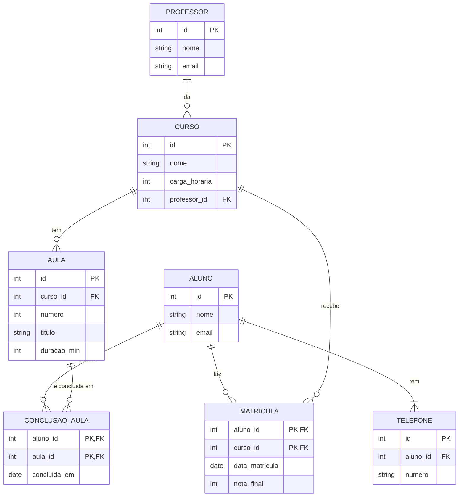
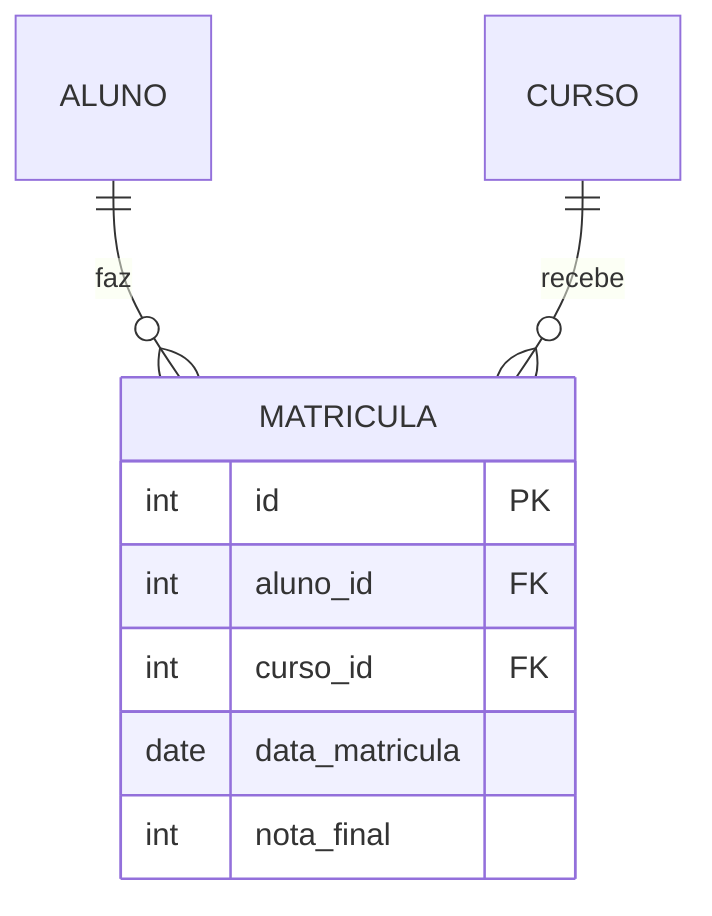

# ✅ Gabarito comentado: revisão

**Revisão da Aula 1 do Módulo 2: Cardinalidade, tabela associativa e normalização**

Este arquivo tem as respostas do **exercício em dupla** (o CursoÁgil) e do **desafio extra**.

> **Como usar o gabarito:** ele não serve para copiar. Serve para **comparar**. Primeiro tente resolver sozinho(a). Depois confira o seu modelo com o daqui. Em modelagem, **existe mais de um caminho certo**: se o seu DER tem nomes diferentes, mas as mesmas entidades, as mesmas ligações e **nenhuma informação repetida**, o seu modelo também está certo.
>
> Se o seu modelo ficou diferente, não apague tudo. Compare **entidade por entidade** com o gabarito e descubra onde está a diferença.

---

## 📑 Sumário

- [✅ Gabarito comentado: revisão](#-gabarito-comentado-revisão)
  - [📑 Sumário](#-sumário)
  - [O DER final](#o-der-final)
  - [As tabelas finais](#as-tabelas-finais)
  - [Um exemplo de `modelo-normalizado.md`](#um-exemplo-de-modelo-normalizadomd)
  - [Por que funciona, passo a passo](#por-que-funciona-passo-a-passo)
  - [🚀 Desafio extra: refazer o curso](#-desafio-extra-refazer-o-curso)
  - [Resposta esperada para a pergunta em dupla](#resposta-esperada-para-a-pergunta-em-dupla)
  - [❓ Dúvidas que costumam aparecer](#-dúvidas-que-costumam-aparecer)

---

## O DER final

O GitHub desenha este diagrama para você. As duas caixas em verde no seu desenho são as **tabelas associativas** (`MATRICULA` e `CONCLUSAO_AULA`), e a `TELEFONE` é a que nasceu da **1FN**.



## As tabelas finais

Com os dados da planilha já distribuídos:

`PROFESSOR`

| id | nome | email |
|---|---|---|
| 1 | Rui Prado | rui@escola.com |
| 2 | Ana Lopes | ana@escola.com |

`CURSO`

| id | nome | carga_horaria | professor_id |
|---|---|---|---|
| 1 | JavaScript | 40 | 1 |
| 2 | SQL | 30 | 2 |

`ALUNO`

| id | nome | email |
|---|---|---|
| 1 | Carla Dias | carla@email.com |
| 2 | Davi Nunes | davi@email.com |

`TELEFONE`

| id | aluno_id | numero |
|---|---|---|
| 1 | 1 | (71) 99999-1111 |
| 2 | 1 | (71) 98888-2222 |
| 3 | 2 | (71) 97777-3333 |

`MATRICULA`

| aluno_id | curso_id | data_matricula | nota_final |
|---|---|---|---|
| 1 | 1 | 2026-08-01 | 9 |
| 1 | 2 | 2026-08-15 | 8 |
| 2 | 1 | 2026-08-02 | 7 |
| 2 | 2 | 2026-08-15 | 6 |

As tabelas `AULA` e `CONCLUSAO_AULA` vêm **só do texto** do cenário (a planilha não tem dados delas), então ficam sem linhas de exemplo:

`AULA`: id, curso_id (FK), numero, titulo, duracao_min

`CONCLUSAO_AULA`: aluno_id (PK, FK), aula_id (PK, FK), concluida_em

> **Prova de que nada se perdeu:** juntando `ALUNO`, `TELEFONE`, `PROFESSOR`, `CURSO` e `MATRICULA` pelos `id`, você reconstrói exatamente as 4 linhas da planilha original.

## Um exemplo de `modelo-normalizado.md`

```markdown
# Modelo normalizado: CursoÁgil

## PROFESSOR
- id (PK)
- nome
- email

## CURSO
- id (PK)
- nome
- carga_horaria
- professor_id (FK → PROFESSOR)

## AULA
- id (PK)
- curso_id (FK → CURSO)
- numero
- titulo
- duracao_min

## ALUNO
- id (PK)
- nome
- email

## TELEFONE
- id (PK)
- aluno_id (FK → ALUNO)
- numero

## MATRICULA
- aluno_id (PK, FK → ALUNO)
- curso_id (PK, FK → CURSO)
- data_matricula
- nota_final

## CONCLUSAO_AULA
- aluno_id (PK, FK → ALUNO)
- aula_id (PK, FK → AULA)
- concluida_em
```

---

## Por que funciona, passo a passo

- **Passo 1:** as **4 entidades principais** são os substantivos com dados próprios. A **matrícula** e a **conclusão de aula** aparecem como substantivos que carregam dados (a **data** e a **nota**, a **data da conclusão**): são sinais de que existe um N:N escondido. O **telefone** aparece como "um ou mais": um campo com várias respostas.
- **Passo 2:** cada entidade ganha um `id`. O campo `telefones` fica no `ALUNO` por enquanto (e vai ser corrigido no Passo 5).
- **Passo 3:** as ligações com o professor e com o curso são **1:N**, e a FK fica no lado do "muitos" (`CURSO.professor_id` e `AULA.curso_id`). As outras duas ligações são **N:N**: um aluno faz vários cursos e um curso recebe vários alunos; um aluno conclui várias aulas e uma aula é concluída por vários alunos. Cada uma vira uma **tabela associativa com duas FKs**, e os dados do "encontro" moram nela: a `data_matricula` e a `nota_final` na `MATRICULA`, a `concluida_em` na `CONCLUSAO_AULA`.
- **Passo 4:** conferindo o **checklist**: toda entidade tem PK; toda FK tem linha; **nenhuma N:N direta**; toda linha tem verbo e `1`/`N`. As duas tabelas associativas em **verde** são o sinal de que os N:N foram resolvidos. São 6 linhas: professor–curso, curso–aula, aluno–matrícula, curso–matrícula, aluno–conclusão e aula–conclusão.
- **Passo 5 (1FN):** a lista dentro da coluna `telefones` quebra a 1FN. Diferente da aula, aqui **não** se divide em linhas: o telefone vira uma **tabela própria** (`TELEFONE`), numa relação **1:N** com o aluno, e a FK `aluno_id` fica no lado do "muitos".
- **Passo 6 (2FN):** a chave é **(aluno, curso)**. O `email_aluno` depende só do **aluno**. A `carga_horaria`, o `professor` e o `email_professor` dependem só do **curso**. A `data_matricula` e a `nota_final` dependem **dos dois**: é a nota daquele aluno naquele curso.
- **Passo 7 (3FN):** em `CURSO`, o `email_professor` depende do **professor** (outra coluna, não da chave): o professor vira uma tabela e o curso guarda só o `professor_id`. A cadeia é **curso → professor → email**.
- **Passo 8 (conferir):** a carga horária do JavaScript fica em **1 lugar** (a planilha tinha **2 linhas** com ela). O email do Rui fica em **1 lugar** (a planilha tinha **2 linhas**). Um telefone novo é **uma linha nova** em `TELEFONE`: na planilha, seria preciso editar a lista nas linhas da Carla.

**Outra forma que também está certa:**
- Chamar as tabelas associativas de outro nome claro (`INSCRICAO`, `AULA_CONCLUIDA`).
- Manter `numero` e `titulo` da `AULA` exatamente como no texto, ou trocar `numero` por `ordem`.
- Deixar o `telefone` como entidade com um campo `tipo` (celular, fixo), se a plataforma precisar.

---

## 🚀 Desafio extra: refazer o curso

1. **A PK `(aluno_id, curso_id)` ainda funciona? Não.** Se o aluno refaz o curso, existem **duas linhas** com o mesmo par (aluno, curso), e uma **PK não pode repetir**.
2. **Discordância Positiva (resposta aberta, qualquer argumento vale).** Duas saídas comuns:
   - **Dar um `id` próprio à `MATRICULA`** e deixar `aluno_id` e `curso_id` como FKs comuns. É a mais simples e a mais usada: cada matrícula é "uma coisa" com seu número.
   - **Incluir a `data_matricula` na PK** `(aluno_id, curso_id, data_matricula)`. Evita criar um `id`, mas a chave fica longa e depende de o aluno não se matricular duas vezes no mesmo dia.
   - O importante é **defender com motivo**. (Repare: é a mesma pergunta de "uma música pode repetir na mesma playlist?" do Bloco 2.)



---

## Resposta esperada para a pergunta em dupla

Qualquer resposta com a mesma ideia vale. A `nota_final` mora na `MATRICULA` porque ela é a nota **de um aluno naquele curso**:

- **Para o aluno:** ele tem uma nota diferente em cada curso. Se a nota ficasse no `ALUNO`, ele teria uma nota só para todos os cursos.
- **Para a plataforma:** a mesma turma tem vários alunos com notas diferentes. Se a nota ficasse no `CURSO`, o curso teria uma nota só para todos os alunos.

Um dado que **depende dos dois lados** de um N:N **mora na tabela associativa**. É a pista mais confiável para saber onde cada campo deve ficar.

---

## ❓ Dúvidas que costumam aparecer

**"O meu DER ficou diferente do gabarito. Está errado?"**
Não necessariamente. Confira **três coisas**: (1) toda entidade tem PK; (2) nenhuma informação aparece em dois lugares; (3) nenhuma linha N:N ficou direta. Se as três estão certas, o seu modelo também está certo.

**"Como decido em qual tabela vai um campo, como a `nota_final`?"**
Pergunte: "esse dado depende de **quê**?" Se depende só do aluno, vai em `ALUNO`. Se só do curso, em `CURSO`. Se depende **dos dois**, vai na tabela associativa.

**"Por que o telefone virou uma tabela e não uma coluna com os números separados por vírgula?"**
Porque a lista numa célula quebra a **1FN**: fica impossível buscar um número, contar quantos telefones um aluno tem ou trocar só um deles.

**"Qual a diferença entre 2FN e 3FN?"**
**2FN** é sobre a **chave composta**: a coluna depende de **parte** da chave (o `email_aluno` depende só do aluno). **3FN** é sobre **outra coluna**: a coluna depende de uma coluna que **não é a chave** (o `email_professor` depende do professor).

**"A 2FN só acontece em tabela com chave composta?"**
Sim. Com uma chave de uma coluna só, não existe "parte da chave". Por isso a 2FN aparece nas tabelas associativas.

**"Normalizar quer dizer separar tudo em tabelas pequenas?"**
Não. Normalizar é **não repetir informação que muda junto**. Separar além disso só complica.

---

**Conseguiu resolver tudo?** Ótimo! Agora **desenhe o DER de um app que você usa** (um app de música, de entrega, de vídeos), com pelo menos **um N:N que carregue dado no "encontro"**. Quem consegue criar o problema entende o conteúdo de verdade. 🚀