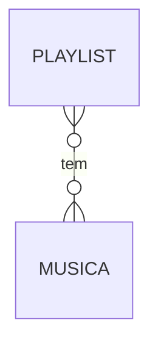
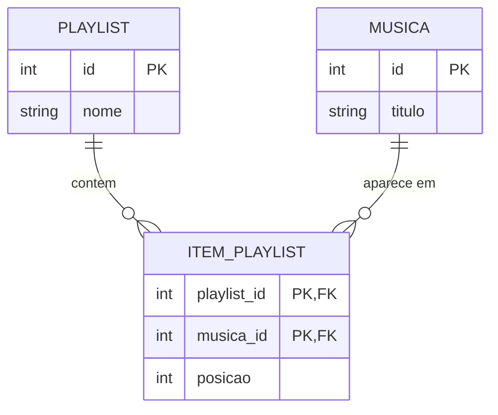

# 🔄 Aula de revisão: Cardinalidade, tabela associativa e normalização

**Revisão da Aula 1 do Módulo 2: Modelagem relacional**

Hoje não tem conteúdo novo. Vamos **reativar** o que você já viu, em 25 minutos, com **mais atenção** a duas coisas: a **cardinalidade com tabela associativa** e as **regras de normalização**. Depois você vai **desenhar e normalizar** um modelo inteiro, em dupla.

Os exemplos da revisão são da **MúsicaÁgil**, um app de música. O exercício, mais adiante, usa outro cenário.

> **Regra de ouro (a mesma de sempre):** faça um passo, confira, siga para o próximo. Um desenho feio e conferido vale mais do que um desenho perfeito que nunca saiu da cabeça.
>
> O material completo continua no `README.md` da Aula 1. Aqui está só o essencial.

---

## 📑 Sumário

1. [Roteiro do dia](#roteiro-do-dia)
2. [Aquecimento](#-aquecimento-3-min)
3. [Bloco 1: entidade, atributo, PK e FK](#bloco-1--entidade-atributo-pk-e-fk-4-min)
4. [Bloco 2: cardinalidade e tabela associativa](#bloco-2--cardinalidade-e-tabela-associativa-9-min)
5. [Bloco 3: as três formas normais](#bloco-3--as-três-formas-normais-9-min)
6. [Exercício em dupla: o CursoÁgil](#-exercício-em-dupla-o-cursoágil)
7. [Fechamento](#-fechamento-15-min)

---

## Roteiro do dia

| Parte | Tempo | O que acontece |
|---|---|---|
| Revisão | até **25 min** | Aquecimento e 3 blocos (o peso está nos blocos 2 e 3) |
| Exercício em dupla | até **45 min** | O CursoÁgil: DER e modelo normalizado |
| Fechamento | **15 min** | Correção ao vivo, retrospectiva e próximo passo |

**Dentro da revisão:**

| Tempo | O que acontece |
|---|---|
| 0 a 3 min | Aquecimento: o que você lembra? |
| 3 a 7 min | Bloco 1: entidade, atributo, PK e FK |
| 7 a 16 min | Bloco 2: cardinalidade e tabela associativa |
| 16 a 25 min | Bloco 3: as três formas normais |

---

## 🔥 Aquecimento (3 min)

Sem olhar o material, responda em voz alta ou numa folha. Se não lembrar, tudo bem: **errar aqui é o objetivo**, porque mostra o que precisa ser revisto.

1. Uma playlist tem várias músicas, e uma música pode estar em várias playlists. Qual é a **cardinalidade**? Que **tabela** falta no modelo?
2. A frase *"a chave, a chave inteira e nada além da chave"* resume **três** regras. Quais são as três formas normais e o que cada uma proíbe?
3. Em um 1:N, a **FK** fica no lado do "um" ou do "muitos"?

<details>
<summary>💡 Ver respostas</summary>

1. **N:N.** Falta a **tabela associativa** (por exemplo, `ITEM_PLAYLIST`), com duas FKs.
2. **1FN:** uma lista dentro de uma célula. **2FN:** coluna que depende de **só parte** da chave composta. **3FN:** coluna que depende de **outra coluna** que não é a chave.
3. No lado do **"muitos"**: quem tem muitos guarda o `id` de quem tem um.

</details>

---

## Bloco 1 · Entidade, atributo, PK e FK (4 min)

**Objetivo:** lembrar as peças do modelo antes de ligar tudo.

| Conceito | O que é | Exemplo (MúsicaÁgil) |
|---|---|---|
| **Entidade** | Um **tipo de ficha** que tem dados próprios e vários exemplares | `MUSICA`, `PLAYLIST`, `USUARIO` |
| **Atributo** | Um **campo** da ficha | `titulo`, `nome` |
| **PK** | O `id`: **não repete e não muda** | `MUSICA.id` |
| **FK** | O `id` de **outra** ficha, guardado aqui, para ligar as duas | `MUSICA.artista_id` |

**💬 E daí?** Sem uma PK, duas músicas com o mesmo título viram uma só para o sistema. Sem FK, não existe ligação: só dado solto.

**✅ Checkpoint:** o **gênero** de uma música (rock, samba...) é uma entidade ou um atributo? Depende. O que você perguntaria para decidir?

<details>
<summary>💡 Ver resposta</summary>

Pergunte: "o gênero tem **dados próprios** e **vários** exemplares?" Se for só um nome, é **atributo** (`genero` em `MUSICA`). Se o gênero tiver descrição, cor, ou várias músicas precisarem apontar para ele, vira **entidade**. Os dois são defensáveis, e o importante é **defender com motivo**.

</details>

---

## Bloco 2 · Cardinalidade e tabela associativa (9 min)

**Objetivo:** classificar relacionamentos e **resolver o N:N** com uma tabela associativa.

**O porquê:** a **cardinalidade** diz quantos de um lado se ligam a quantos do outro. Use sempre a **regra das duas perguntas**:

> **1. Um A tem quantos B? 2. Um B tem quantos A?**

| Respostas | Cardinalidade | Exemplo (MúsicaÁgil) | Onde fica a FK |
|---|---|---|---|
| um e um | **1:1** | **Usuário** e **Perfil** | Em qualquer lado (costuma ficar em quem depende do outro) |
| um e muitos | **1:N** | **Artista** e **Música** | `artista_id` em `MUSICA` (o lado do "muitos") |
| muitos e muitos | **N:N** | **Playlist** e **Música** | Numa **terceira tabela** |

### O N:N nunca fica direto

Uma playlist tem várias músicas, e uma música está em várias playlists. Esse "encontro" ganha uma **tabela associativa**, com **duas FKs** que, juntas, formam a **PK**. O dado que pertence ao encontro (a **posição** da música na playlist) mora nela:



vira:



### 🎨 Redesenhe com a turma no Excalidraw: do N:N à tabela associativa
**Tempo de desenho:** até 3 min (use o [guia rápido do Excalidraw](README.md#guia-rápido-do-excalidraw) da Aula 1)

**Ordem do desenho:**
1. Caixas `PLAYLIST` e `MUSICA` lado a lado, com uma linha **vermelha** entre elas e `N` nas duas pontas: o **problema** (🔴)
2. **Apague a linha** e ponha uma caixa **verde** `ITEM_PLAYLIST` no meio, com `playlist_id (FK)`, `musica_id (FK)` e `posicao` (🟢)
3. Ligue `PLAYLIST 1 — N ITEM_PLAYLIST` e `MUSICA 1 — N ITEM_PLAYLIST` (⚪)

**Esboço do layout:**
```
 ANTES (🔴)                        DEPOIS (🟢)

 ┌──────────┐ N      N ┌────────┐   ┌──────────┐ 1   N ┌───────────────┐ N   1 ┌────────┐
 │ PLAYLIST ├──────────┤ MUSICA │   │ PLAYLIST ├───────┤ ITEM_PLAYLIST ├───────┤ MUSICA │
 └──────────┘          └────────┘   └──────────┘       │ posicao       │       └────────┘
                                                        └───────────────┘
```

**Pergunta para a turma antes de revelar:** "Onde fica a **posição** da música na playlist? Em PLAYLIST? Em MUSICA?" (Nenhuma das duas: no **ITEM_PLAYLIST**.)

### As ligações no código

O arquivo `livecoding/revisao.js` mostra a tabela associativa funcionando: a playlist e a música só se encontram em `itensPlaylist`.

```js
// Cada "tabela" é um array de objetos. As ligações são feitas por id.
const usuarios = [
  { id: 1, nome: 'Marina' },
  { id: 2, nome: 'Diego' },
];
const artistas = [
  { id: 1, nome: 'Banda Litoral' },
  { id: 2, nome: 'Zeca do Bairro' },
];
const musicas = [
  { id: 1, titulo: 'Sol de Verão', artistaId: 1 },
  { id: 2, titulo: 'Maré Alta', artistaId: 1 },
  { id: 3, titulo: 'Trem das Onze', artistaId: 2 },
];
const playlists = [
  { id: 1, nome: 'Treino', usuarioId: 1 },
  { id: 2, nome: 'Estudo', usuarioId: 2 },
];

// N:N entre playlist e música: a tabela associativa guarda as duas FKs
// e o dado do "encontro" (a posição da música na playlist)
const itensPlaylist = [
  { playlistId: 1, musicaId: 1, posicao: 1 },
  { playlistId: 1, musicaId: 3, posicao: 2 },
  { playlistId: 2, musicaId: 1, posicao: 1 },
  { playlistId: 2, musicaId: 2, posicao: 2 },
  { playlistId: 2, musicaId: 3, posicao: 3 },
];

function montarPlaylist(idDaPlaylist) {
  const playlist = playlists.find(p => p.id === idDaPlaylist);
  const dono = usuarios.find(u => u.id === playlist.usuarioId);
  const itens = itensPlaylist.filter(i => i.playlistId === idDaPlaylist);
  const titulos = itens.map(item => musicas.find(m => m.id === item.musicaId).titulo);
  return { playlist: playlist.nome, dono: dono.nome, musicas: titulos };
}

console.log(montarPlaylist(1));
console.log(montarPlaylist(2));

// N:N visto do outro lado: em quantas playlists "Sol de Verão" aparece?
const solDeVerao = musicas.find(m => m.titulo === 'Sol de Verão');
console.log(itensPlaylist.filter(i => i.musicaId === solDeVerao.id).length);

// Normalização: renomear a música em UM lugar só vale para todas as playlists
const musicasAtualizadas = musicas.map(m =>
  m.id === 1 ? { ...m, titulo: 'Sol de Verão (Ao Vivo)' } : m
);
const titulosDaPlaylist2 = itensPlaylist
  .filter(i => i.playlistId === 2)
  .map(i => musicasAtualizadas.find(m => m.id === i.musicaId).titulo);
console.log(titulosDaPlaylist2);
```

Resultado esperado no terminal (`node livecoding/revisao.js`):

```
{
  playlist: 'Treino',
  dono: 'Marina',
  musicas: [ 'Sol de Verão', 'Trem das Onze' ]
}
{
  playlist: 'Estudo',
  dono: 'Diego',
  musicas: [ 'Sol de Verão', 'Maré Alta', 'Trem das Onze' ]
}
2
[ 'Sol de Verão (Ao Vivo)', 'Maré Alta', 'Trem das Onze' ]
```

- `montarPlaylist`: a playlist e as músicas se encontram **só** na `itensPlaylist` (o N:N).
- `2`: "Sol de Verão" aparece em **2** playlists (o N:N visto do outro lado).
- A última linha: renomear a música **em um lugar só** vale para todas as playlists. É a normalização funcionando.

**💬 E daí?** Se o N:N ficasse direto (ou numa lista dentro de uma célula), a plataforma não saberia em quantas playlists uma música aparece nem em que ordem tocar.

**✅ Checkpoint:** uma música pode ter **vários artistas** (uma participação especial), e um artista tem **várias músicas**. Qual a cardinalidade? O que muda no modelo?

<details>
<summary>💡 Ver resposta</summary>

**N:N.** O `artista_id` em `MUSICA` não serve mais: precisa de uma **tabela associativa** (por exemplo, `MUSICA_ARTISTA`), com `musica_id` e `artista_id`. Ela ainda pode guardar um dado do "encontro", como o `papel` (principal ou participação).

</details>

---

## Bloco 3 · As três formas normais (9 min)

**Objetivo:** aplicar a **1FN**, a **2FN** e a **3FN** perguntando a coisa certa em cada uma.

**O porquê:** **normalizar** é arrumar as tabelas para que **cada informação more em um lugar só**. Uma frase para guardar:

> **"A chave, a chave inteira e nada além da chave."**

| Forma normal | Pergunta-teste | Quando quebra |
|---|---|---|
| **1FN** | Tem uma **lista** dentro de uma célula? | Um valor por célula: `tags: "rock, verao"` |
| **2FN** | A coluna depende da **chave inteira** ou só de uma **parte**? | Só acontece com **chave composta** |
| **3FN** | A coluna depende de **outra coluna** que não é a chave? | A mesma informação se repete junto com outra (`Banda Litoral` sempre com `Brasil`) |

### Três tabelas com defeito (cada uma quebra uma forma)

**Tabela A: `musica`** (chave: `id`)

| id | titulo | tags |
|---|---|---|
| 1 | Sol de Verão | verao, praia |
| 2 | Maré Alta | praia |

**Tabela B: `item_playlist`** (chave composta: `playlist_id` + `musica_id`)

| playlist_id | musica_id | titulo_musica | posicao |
|---|---|---|---|
| 1 | 1 | Sol de Verão | 1 |
| 1 | 3 | Trem das Onze | 2 |
| 2 | 1 | Sol de Verão | 1 |

**Tabela C: `musica`** (chave: `id`)

| id | titulo | artista | pais_artista |
|---|---|---|---|
| 1 | Sol de Verão | Banda Litoral | Brasil |
| 2 | Maré Alta | Banda Litoral | Brasil |
| 3 | Trem das Onze | Zeca do Bairro | Brasil |

**Para cada uma:** qual forma normal quebra? Por quê? Como fica corrigida?

<details>
<summary>💡 Ver respostas</summary>

- **A: 1FN.** A coluna `tags` tem uma **lista numa célula**. Fica `MUSICA` (id, titulo) e `TAG` (id, musica_id, nome).
- **B: 2FN.** O `titulo_musica` depende **só do `musica_id`** (uma parte da chave). Fica `MUSICA` (id, titulo) e `ITEM_PLAYLIST` (playlist_id, musica_id, posicao).
- **C: 3FN.** O `pais_artista` depende do `artista` (**outra coluna**, não da chave). Fica `ARTISTA` (id, nome, pais) e `MUSICA` (id, titulo, artista_id).

</details>

**A exceção que dá o que pensar:** guardar um dado "repetido" nem sempre é redundância. Se a plataforma cobra por assinatura e o preço da assinatura mudar, o **valor cobrado no mês passado** não pode mudar. O **valor cobrado** é um fato histórico, e **não muda junto** com o preço atual.

> **Normalizar não é separar tudo.** É não repetir informação que **muda junto**.

**💬 E daí?** Se o país do artista estiver escrito em cada música, e um dia alguém corrigir só uma linha, a plataforma passa a dizer que o mesmo artista é de dois países. Dado repetido sempre acaba divergindo.

**✅ Checkpoint:** a **2FN** pode ser quebrada numa tabela com **chave de uma coluna só** (como `id`)? Por quê?

<details>
<summary>💡 Ver resposta</summary>

**Não.** A 2FN fala de colunas que dependem de **só parte** da chave. Com uma chave de uma coluna só, não existe "parte": ou a coluna depende da chave, ou não depende. Por isso a 2FN só aparece em tabelas com **chave composta**, como as tabelas associativas.

</details>

---

## 👥 Exercício em dupla: o CursoÁgil

**Tempo:** até 45 minutos (estimativa: 41 min, com folga). Uma pessoa é a **pilota** (desenha e digita) e a outra é a **navegadora** (lê o enunciado e confere). **Troquem de papel a cada passo.**

### 🎯 O cenário

O CursoÁgil é uma plataforma de cursos online e controla tudo numa planilha. Você vai **desenhar o DER** e **normalizar o modelo**.

> O CursoÁgil é uma plataforma de cursos online. Cada **curso** tem nome e carga horária, e é dado por um **professor** (que tem nome e email e pode dar vários cursos). Cada curso tem várias **aulas**, numeradas, com título e duração em minutos. Os **alunos** têm nome, email e **um ou mais telefones**. Um aluno **se matricula** em vários cursos e cada curso recebe vários alunos; na matrícula, a plataforma registra a **data** e a **nota final** do aluno naquele curso. O aluno também **marca como concluídas** as aulas que já assistiu, e a plataforma guarda **quando** ele concluiu cada uma.

A planilha de matrículas:

| aluno | email_aluno | telefones | curso | carga_horaria | professor | email_professor | data_matricula | nota_final |
|---|---|---|---|---|---|---|---|---|
| Carla Dias | carla@email.com | (71) 99999-1111, (71) 98888-2222 | JavaScript | 40 | Rui Prado | rui@escola.com | 2026-08-01 | 9 |
| Carla Dias | carla@email.com | (71) 99999-1111, (71) 98888-2222 | SQL | 30 | Ana Lopes | ana@escola.com | 2026-08-15 | 8 |
| Davi Nunes | davi@email.com | (71) 97777-3333 | JavaScript | 40 | Rui Prado | rui@escola.com | 2026-08-02 | 7 |
| Davi Nunes | davi@email.com | (71) 97777-3333 | SQL | 30 | Ana Lopes | ana@escola.com | 2026-08-15 | 6 |

### 📦 O que a dupla entrega

1. O **DER** em imagem (PNG exportado do Excalidraw) ou o link.
2. Um arquivo `modelo-normalizado.md` com as tabelas finais (PK e FK marcadas), no mesmo esqueleto da Aula 1.

### 🧭 Como a dupla trabalha (High Agency na prática)

- **Bias to Action:** faça um **rascunho** de DER logo no começo e corrija conforme avança.
- **Clear Thinking:** antes de criar uma entidade ou um campo, responda em voz alta: **"quem vai usar essa informação e para quê?"**
- **Discordância Positiva:** em pelo menos **2 passos**, a navegadora propõe **outra forma** de modelar. A dupla testa as duas e escolhe com argumento, **não** quem fala mais alto.

### 🪜 Os passos

Confira o **resultado esperado** de cada passo antes de seguir.

**Passo 1 (3 min): Grifar.** Leia o texto do cenário. Grife os **substantivos** (candidatas a entidade) e os **verbos** (relacionamentos). Anote as duas listas.
> Resultado esperado: **4 entidades principais** (professor, curso, aula, aluno) e **2 "encontros" com dados próprios** (a matrícula, com data e nota, e a conclusão de aula, com a data). **Telefone** aparece como "um ou mais" (um campo com várias respostas). Os verbos: o professor **dá** cursos, o curso **tem** aulas, o aluno **se matricula**, o aluno **marca como concluída**.

**Passo 2 (5 min): Atributos e chave primária.** Para as 4 entidades principais, liste os atributos e escolha a **PK** (um `id`). Ainda **não** coloque as FKs.
> Resultado esperado:
> - `PROFESSOR`: id, nome, email
> - `CURSO`: id, nome, carga_horaria
> - `AULA`: id, numero, titulo, duracao_min
> - `ALUNO`: id, nome, email, telefones (este campo vai dar o que falar no Passo 5)

**Passo 3 (6 min): Cardinalidades e tabelas associativas.** Para cada par ligado, faça as duas perguntas. Diga a cardinalidade e **onde fica a FK** (ou qual **tabela associativa** é preciso criar, e **que dados moram nela**).
> Resultado esperado:
>
> | Relação | Um A tem quantos B? | Um B tem quantos A? | Cardinalidade | FK ou tabela |
> |---|---|---|---|---|
> | Professor e Curso | muitos | um | **1:N** | `CURSO.professor_id` |
> | Curso e Aula | muitos | um | **1:N** | `AULA.curso_id` |
> | Aluno e Curso | muitos | muitos | **N:N** | **`MATRICULA`** (aluno_id, curso_id, **data_matricula**, **nota_final**) |
> | Aluno e Aula | muitos | muitos | **N:N** | **`CONCLUSAO_AULA`** (aluno_id, aula_id, **concluida_em**) |

**Passo 4 (12 min): O DER no Excalidraw.** Desenhe o diagrama com as entidades, as linhas (verbo e `1`/`N`), as FKs e as **duas tabelas associativas em verde**. Passe pelo checklist de um bom DER.
> Resultado esperado: **6 caixas** (4 entidades + `MATRICULA` e `CONCLUSAO_AULA` em verde) e **6 linhas**, cada uma com verbo e `1`/`N` nas duas pontas, PK e FK marcadas, **nenhuma linha N:N direta**.

**Passo 5 (3 min): 1ª forma normal.** Na planilha, a coluna `telefones` tem uma **lista** em cada célula. Corrija.
> Resultado esperado: a coluna `telefones` **sai** da planilha e nasce uma **tabela `TELEFONE`** (1:N com o aluno):
>
> | id | aluno_id | numero |
> |---|---|---|
> | 1 | 1 | (71) 99999-1111 |
> | 2 | 1 | (71) 98888-2222 |
> | 3 | 2 | (71) 97777-3333 |
>
> **Atualize o DER:** acrescente a caixa `TELEFONE` (em verde), ligada ao aluno.

**Passo 6 (4 min): 2ª forma normal.** A chave da planilha é **(aluno, curso)**. Quais colunas dependem **só de uma parte** da chave? Separe em tabelas.
> Resultado esperado: **3 tabelas** (colunas):
> - `ALUNO`: aluno, email_aluno (dependem **só do aluno**)
> - `CURSO`: curso, carga_horaria, professor, email_professor (dependem **só do curso**)
> - `MATRICULA`: aluno, curso, data_matricula, nota_final (dependem **dos dois**)

**Passo 7 (4 min): 3ª forma normal.** Na tabela `CURSO`, alguma coluna depende de **outra coluna que não é a chave**? Separe, e passe a usar `id` como chave.
> Resultado esperado: o `email_professor` depende do **professor** (e não do curso): nasce a tabela **`PROFESSOR`** (id, nome, email), e `CURSO` fica com (id, nome, carga_horaria, **professor_id**). No fim, são **7 tabelas** no modelo todo: `PROFESSOR`, `CURSO`, `AULA`, `ALUNO`, `TELEFONE`, `MATRICULA` e `CONCLUSAO_AULA`.

**Passo 8 (4 min): Conferir.** Olhando para o seu modelo, responda e **compare com a planilha original**:
1. A carga horária de JavaScript mudou de 40 para 45 horas. Em **quantos lugares** você muda?
2. O email do professor Rui mudou. Em **quantos lugares** você muda?
3. A Carla ganhou um terceiro telefone. O que você faz?
> Resultado esperado: **1 lugar** (a linha do JavaScript em `CURSO`; na planilha eram **2 linhas**); **1 lugar** (a linha do Rui em `PROFESSOR`; na planilha eram **2 linhas**); **uma linha nova** em `TELEFONE`, sem mexer em mais nada.

**🚀 Desafio extra: refazer o curso.** E se um aluno puder **refazer o mesmo curso** (reprovou e voltou no semestre seguinte)?
1. A PK `(aluno_id, curso_id)` da `MATRICULA` ainda funciona? Por quê?
2. **Discordância Positiva:** como você resolveria? Defendam **um lado** com **um argumento**.

**Pergunta para responder em dupla** (num comentário no topo do `modelo-normalizado.md`): por que a `nota_final` mora na `MATRICULA`, e não no `ALUNO` nem no `CURSO`? Escrevam **uma frase pensando no aluno** e **uma pensando na plataforma**.

### 🐞 Se algo não bater

| O que aparece | O que provavelmente aconteceu |
|---|---|
| A `nota_final` ficou em `ALUNO` ou `CURSO` | O dado pertence ao **encontro** dos dois: vai na tabela associativa |
| Uma **linha N:N direta** entre Aluno e Curso | Falta a tabela associativa (`MATRICULA`) |
| O `telefones` virou uma coluna com lista | Quebra a **1FN**: vira outra tabela (1:N) |
| Dúvida entre 2FN e 3FN | 2FN: a coluna depende de **parte** da chave. 3FN: depende de **outra coluna** |
| `TELEFONE` sem FK para o aluno | A FK fica no lado do **"muitos"** |

### ✅ Antes de entregar

- [ ] O DER passa no **checklist de um bom DER**?
- [ ] As **7 tabelas finais** estão no `modelo-normalizado.md`, com PK e FK?
- [ ] A dupla trocou de papel a cada passo?
- [ ] Alguém na dupla consegue explicar, **com as próprias palavras**, por que o dado da `MATRICULA` mora na tabela associativa?
- [ ] A dupla discordou de forma positiva em pelo menos 2 passos?

---

## 🏁 Fechamento (15 min)

| Min | Atividade | Objetivo |
|---|---|---|
| 0 a 5 | **Correção ao vivo**: uma dupla mostra o DER e a turma confere com o checklist | Bias to Action: conferir no desenho, não na opinião |
| 5 a 10 | **Retrospectiva**: "onde travamos, o que tentamos, o que funcionou" | Transformar dificuldade em informação |
| 10 a 13 | **Conexão**: onde, num app que você usa, existe um N:N com dado no "encontro"? | Clear Thinking: valor para alguém |
| 13 a 15 | **Próximo passo** e liberação do gabarito | Algo para fazer em menos de 30 minutos |

**Próximo passo físico:** esta noite, abra o seu DER e ache **uma** informação que ainda está escrita em dois lugares.