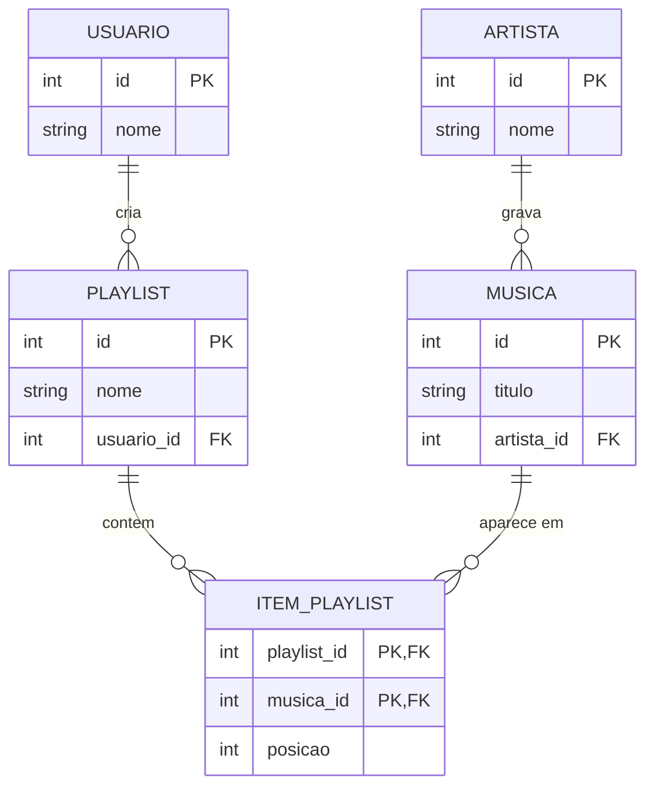
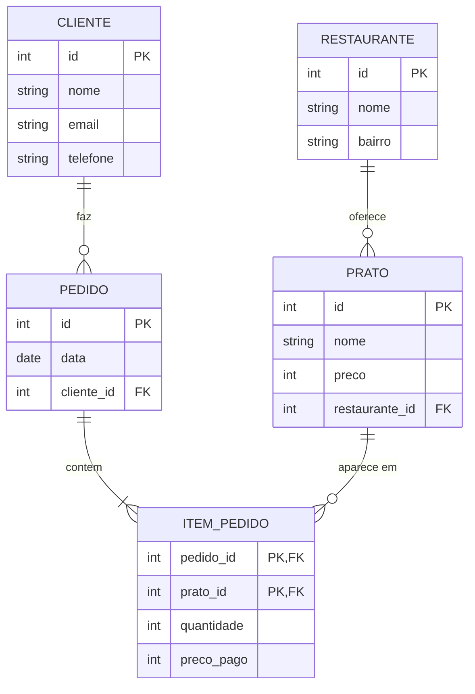

# 🔄 Aula de revisão: o primeiro servidor Express e do modelo à API

**Revisão da Aula 3 do Módulo 2: Projeto de modelagem + Meu primeiro servidor Express**

Hoje não tem conteúdo novo. Vamos **reativar** o que você já viu, em 25 minutos, com atenção a três coisas: o **caminho de um pedido** (e o que cada erro quer dizer), a **anatomia de uma rota `GET`** e a **ligação entre o modelo (DER) e as rotas da API**. Depois você vai **criar um servidor do zero** e **transformar um DER em mapa de API**, em dupla.

Os exemplos da revisão são da **MúsicaÁgil**, o app de música das revisões anteriores. O exercício, mais adiante, usa outro cenário: o **RangoÁgil**.

> **Regra de ouro (a mesma de sempre):** um passo, roda, confere. Escreva uma linha, salve, teste com o `curl`, olhe o resultado. Se der erro, leia a mensagem com calma: ela é uma pista, não uma bronca.
>
> O material completo continua no `README.md` da Aula 3. Aqui está só o essencial.

---

## 📑 Sumário

1. [Roteiro do dia](#roteiro-do-dia)
2. [Como usar este material](#-como-usar-este-material)
3. [Aquecimento](#-aquecimento-3-min)
4. [Bloco 1: o caminho do pedido](#bloco-1--o-caminho-do-pedido-7-min)
5. [Bloco 2: a anatomia de uma rota GET](#bloco-2--a-anatomia-de-uma-rota-get-8-min)
6. [Bloco 3: do DER ao mapa de URLs](#bloco-3--do-der-ao-mapa-de-urls-7-min)
7. [Exercício em dupla: o RangoÁgil](#-exercício-em-dupla-o-rangoágil)
8. [Fechamento](#-fechamento-15-min)

---

## Roteiro do dia

| Parte | Tempo | O que acontece |
|---|---|---|
| Revisão | até **25 min** | Aquecimento e 3 blocos |
| Exercício em dupla | até **45 min** | O RangoÁgil: um servidor do zero (Parte A) e o mapa da API a partir do DER (Parte B) |
| Fechamento | **15 min** | Correção ao vivo, retrospectiva e próximo passo |
| **Total** | **85 min** | |

**Dentro da revisão:**

| Tempo | O que acontece |
|---|---|
| 0 a 3 min | Aquecimento: o que você lembra? |
| 3 a 10 min | Bloco 1: o caminho do pedido (cliente, servidor, rota, status) |
| 10 a 18 min | Bloco 2: a anatomia de uma rota `GET` (e o Nodemon) |
| 18 a 25 min | Bloco 3: do DER ao mapa de URLs |

---

## 💻 Como usar este material

1. Você precisa do **Node.js 22** e de **internet** para o `npm install`.
2. O servidor da revisão está em [`livecoding/musicaagil-api`](livecoding/musicaagil-api/). Para rodar na sua máquina:

```bash
cd livecoding/musicaagil-api
npm install
npm run dev
```

3. Para testar, use o **navegador** ou o **curl** num **segundo terminal**:

```bash
curl -i http://localhost:3000/musicas
```

> **No Windows (PowerShell),** escreva `curl.exe` em vez de `curl`.
>
> **Só um servidor por porta.** Antes de ligar o servidor do exercício, desligue o da revisão (`Ctrl + C` no terminal dele).

Este material foi testado com **Node.js 22**, **Express 5.3.0** e **Nodemon 3.1.14**. As linhas `Date` e `ETag` das respostas mudam a cada teste: não precisam bater.

---

## 🔥 Aquecimento (3 min)

Sem olhar o material, responda em voz alta ou numa folha. Se não lembrar, tudo bem: **errar aqui é o objetivo**, porque mostra o que precisa ser revisto.

1. Você testou uma rota e apareceu `Cannot GET /musica`. O servidor está **ligado** ou **desligado**?
2. Qual a diferença entre `res.send(...)` e `res.json(...)`?
3. No projeto do IngressoÁgil, a Roda de Samba faturou **85**, e não 90. **Em qual tabela** morava o número que fez a conta dar certo?

<details>
<summary>💡 Ver respostas</summary>

1. **Ligado.** Ele respondeu (status `404`): só não existe essa rota no cardápio. Desligado, o `curl` nem recebe resposta (`curl: (7) Failed to connect`).
2. O `res.send` devolve um **texto**. O `res.json` devolve **dados** (objeto ou array) em JSON. Os dois respondem com `200`.
3. Na tabela que liga **compra e evento** (o item da compra), no **preço pago**. O preço do evento é o de **hoje**; o preço pago é o **do dia da compra**.

</details>

---

## Bloco 1 · O caminho do pedido (7 min)

**Objetivo:** reconhecer as **três respostas** que um pedido pode ter e saber **onde procurar** o problema em cada uma.

**O porquê:** lembra do **restaurante**? O **cliente** (navegador, app, `curl`) faz um **pedido**. A **cozinha** (o servidor) procura no **cardápio** (as rotas) e devolve um **prato** (a resposta): um **status** e os dados.

| No restaurante | Na API |
|---|---|
| O pedido: "me vê as músicas" | A **requisição**: `GET /musicas` |
| O cardápio | As **rotas** que o servidor conhece |
| O prato | A **resposta**: status + dados em JSON |
| "Isso a gente não tem" | **404** |
| O restaurante está **fechado** | O `curl` nem recebe resposta |

### Primeiro, o pedido que dá certo

Com o servidor da MúsicaÁgil ligado:

```bash
curl -i http://localhost:3000/musicas
```

```
HTTP/1.1 200 OK
X-Powered-By: Express
Content-Type: application/json; charset=utf-8
Content-Length: 142
ETag: W/"8e-rehc5fVTpX3+nN8/WT/vrhfEwlQ"
Date: Mon, 23 Nov 2026 13:13:53 GMT
Connection: keep-alive
Keep-Alive: timeout=5

[{"id":1,"titulo":"Sol de Verão","artistaId":1},{"id":2,"titulo":"Maré Alta","artistaId":1},{"id":3,"titulo":"Trem das Onze","artistaId":2}]
```

Olhe só **duas partes**: a **primeira linha** (`200 OK`: deu certo) e a **última** (os dados).

### Agora, os dois problemas

**Caminho errado** (no singular):

```bash
curl -i http://localhost:3000/musica
```

```
HTTP/1.1 404 Not Found
...
<pre>Cannot GET /musica</pre>
...
```

**Servidor desligado** (aperte `Ctrl + C` no terminal do servidor e teste de novo):

```bash
curl -i http://localhost:3000/musicas
```

```
curl: (7) Failed to connect to localhost port 3000 after 0 ms: Couldn't connect to server
```

O número de milissegundos (`0 ms`) pode mudar. **Ligue o servidor de novo** (`npm run dev`) antes de seguir.

### As três respostas, lado a lado

| O que aparece | O que quer dizer | Onde procurar o problema |
|---|---|---|
| `200 OK` + dados | Deu certo | Nenhum lugar 🎉 |
| `404 Not Found` + `Cannot GET /caminho` | O servidor está **ligado**, mas **não tem essa rota** | No **caminho**: letra por letra, plural, a rota existe no código? |
| `curl: (7) Failed to connect` | O pedido **nem chegou**: o servidor está **desligado** (ou em outra porta) | No **terminal do servidor**: ele está ligado? Na porta 3000? |

### 🎨 Redesenhe com a turma no Excalidraw: o ciclo do pedido
**Tempo de desenho:** até 3 min

**Ordem do desenho:**
1. À esquerda, o **cliente**: um retângulo com `navegador / app / curl` (⚪)
2. À direita, uma caixa grande **servidor :3000** com o **cardápio** dentro: `GET /`, `GET /musicas`, `GET /artistas` (🔵)
3. Uma seta do cliente para o servidor com `GET /musicas`, que **chega** no item do cardápio, e uma seta de volta com `200 + JSON` (🟢)
4. Uma segunda seta com `GET /musica`, que **não acha** nada no cardápio, e volta com `404 Cannot GET /musica` (🔴)
5. Uma terceira seta, **pontilhada**, que **para no meio do caminho** com um X: `curl: (7)`. Desenhe a caixa do servidor **pontilhada** nesse caso: "desligado" (🔴)
6. Legenda embaixo: "voltou resposta = servidor ligado" (⚪)

**Esboço do layout:**
```
 ┌───────────┐   GET /musicas ──────────────▶  ┌──────────────────────┐
 │  CLIENTE  │   ◀────────────── 200 + JSON 🟢 │ SERVIDOR :3000       │
 │ navegador │                                 │  cardápio:           │
 │ app, curl │   GET /musica ───────────────▶  │   GET /              │
 │           │   ◀──── 404 Cannot GET 🔴       │   GET /musicas       │
 └───────────┘                                 │   GET /artistas      │
                 GET /musicas ┄┄┄┄┄┄ ✕ (7) 🔴  └┄┄┄┄┄┄┄┄┄┄┄┄┄┄┄┄┄┄┄┄┄┄┘
                                                 (pontilhado = desligado)
```

**Pergunta para a turma antes de revelar o caso 3:** "Nos casos 2 e 3 deu errado. Em qual deles a **cozinha está aberta**? Como você sabe?" (No caso 2: ela **respondeu**, mesmo que fosse para dizer "não tenho".)

**Frase para fechar o desenho:** "Se voltou uma resposta, o servidor está ligado. 404 é problema de **cardápio**; `(7)` é **cozinha fechada**."

**💬 E daí?** Quem sabe ler essas três respostas resolve em **um minuto** o que outra pessoa leva meia hora mexendo no código errado. Um `404` não se resolve reiniciando o servidor, e um `(7)` não se resolve mexendo na rota. Em entrevista de back-end, "o que você faz quando a API devolve 404?" é pergunta comum.

**✅ Checkpoint:** a sua colega testou `GET /artista` e recebeu `Cannot GET /artista`. Ela quer reinstalar o Express. O que você diria a ela, **com um argumento**?

<details>
<summary>💡 Ver resposta</summary>

Não precisa reinstalar nada: o servidor **respondeu**, então o Express está instalado e ligado. O problema está no **caminho**: a rota no código é `/artistas`, no **plural**.

</details>

---

## Bloco 2 · A anatomia de uma rota GET (8 min)

**Objetivo:** lembrar as peças de uma rota, a diferença entre `res.send` e `res.json` e por que usamos o Nodemon.

**O porquê:** uma **rota** é **um item do cardápio**: "quando chegar **este** pedido, **neste** caminho, faça **isto**". Toda rota `GET` tem o **mesmo molde**. Muda o caminho e muda o dado; o resto fica igual.

### As rotas da MúsicaÁgil

O servidor completo está em [`livecoding/musicaagil-api/index.js`](livecoding/musicaagil-api/index.js). As rotas:

<!-- node:skip -->
```js
// Rota: GET em "/" responde com um TEXTO
app.get('/', (req, res) => {
  res.send('Bem-vindo à API da MúsicaÁgil!');
});

// Rota: GET em "/musicas" responde com DADOS (JSON)
app.get('/musicas', (req, res) => {
  res.json(musicas);
});
```

| Pedaço | O que significa |
|---|---|
| `app.get` | "Quando chegar um pedido **GET** (me mostra)..." |
| `'/musicas'` | "...**neste caminho**..." |
| `(req, res) => { ... }` | "...faça isto." O Express chama essa função **a cada pedido** |
| `req` | O **pedido** que chegou (hoje ainda não usamos) |
| `res` | O **prato** que vamos devolver |
| `res.json(musicas)` | Devolve os dados **em JSON**, com status `200` |

### `res.send` ou `res.json`?

A diferença aparece na etiqueta `Content-Type` da resposta (`curl -i`):

```bash
curl -i http://localhost:3000/
```

```
HTTP/1.1 200 OK
X-Powered-By: Express
Content-Type: text/html; charset=utf-8
...
Bem-vindo à API da MúsicaÁgil!
```

```bash
curl -i http://localhost:3000/artistas
```

```
HTTP/1.1 200 OK
X-Powered-By: Express
Content-Type: application/json; charset=utf-8
...
[{"id":1,"nome":"Banda Litoral"},{"id":2,"nome":"Zeca do Bairro"}]
```

| Quero responder... | Uso | A etiqueta diz |
|---|---|---|
| Um **texto** (boas-vindas, aviso) | `res.send('...')` | `Content-Type: text/html` |
| **Dados** (objeto ou array) | `res.json(dados)` | `Content-Type: application/json` |

### Primeiro, o problema: "mudei e não mudou"

Com o servidor ligado por `node index.js` (**sem** Nodemon), troque o texto da rota `/` para `'Olá! Esta é a API da MúsicaÁgil.'`, salve e teste:

```bash
curl http://localhost:3000/
```

```
Bem-vindo à API da MúsicaÁgil!
```

O texto **não mudou**: o servidor continua rodando a versão que ele leu quando foi ligado.

### A solução: `npm run dev`

Com o Nodemon (script `"dev": "nodemon index.js"`), cada vez que você salva, o terminal do servidor mostra:

```
[nodemon] restarting due to changes...
[nodemon] starting `node index.js`
Servidor da MúsicaÁgil rodando em http://localhost:3000
```

E o mesmo teste já traz o texto novo:

```
Olá! Esta é a API da MúsicaÁgil.
```

> **E o `EADDRINUSE`?** Se você esquecer o `npm run dev` ligado e rodar `npm start` em outro terminal, aparece `Não consegui ligar o servidor: listen EADDRINUSE: address already in use 0.0.0.0:3000`. Só cabe **um** servidor por porta. Feche um dos dois com `Ctrl + C`. (No seu computador, o final pode aparecer como `:::3000`.)

### 🎨 Redesenhe com a turma no Excalidraw: a anatomia de uma rota GET
**Tempo de desenho:** até 3 min

**Ordem do desenho:**
1. Escreva **grande**, numa linha só: `app.get( '/musicas' , (req, res) => { res.json(musicas) } )` (⚪)
2. Circule `get` e escreva embaixo: "**método**: me mostra" (🔵)
3. Circule `'/musicas'`: "**caminho**: o quê" (🔵)
4. Circule `req` ("o pedido que chegou") e `res` ("o prato que vou devolver") (⚪)
5. Circule `res.json(musicas)`: "**o prato**: 200 + JSON" (🟢)
6. Ao lado, duas variações: `res.send('Bem-vindo...')` → "texto" (🟢) e `res.jason(...)` riscado → "500: a cozinha errou" (🔴)

**Esboço do layout:**
```
   app.get(  '/musicas' ,  (req, res) => {  res.json(musicas)  }  )
       ▲          ▲          ▲     ▲            ▲
   método 🔵  caminho 🔵   pedido  prato ⚪    o prato: 200 + JSON 🟢

   variações:   res.send('Bem-vindo...')  → texto        🟢
                res.jason(musicas)         → 500, erro   🔴
```

**Pergunta para a turma antes de revelar:** "Para criar `GET /artistas`, quais círculos eu mudo?" (Só o **caminho** e o **dado**: `'/artistas'` e `artistas`.)

**Frase para fechar o desenho:** "Rota = método + caminho + o que fazer. Muda o caminho e o dado; o molde fica igual."

**💬 E daí?** O time do app não precisa saber **como** você guardou as músicas. Ele só precisa saber que `GET /musicas` devolve um array em JSON. É esse "contrato" que deixa dois times trabalharem ao mesmo tempo.

**✅ Checkpoint:** escreva a rota `GET /playlists`, que responde com um array `playlists`. Qual método da resposta você usou, e por quê?

<details>
<summary>💡 Ver resposta</summary>

<!-- node:skip -->
```js
app.get('/playlists', (req, res) => {
  res.json(playlists);
});
```

`res.json`, porque a resposta são **dados** (um array), e o app vai usar esses dados para montar a tela. O `res.send` é para **texto**.

</details>

---

## Bloco 3 · Do DER ao mapa de URLs (7 min)

**Objetivo:** ligar as duas partes da Aula 3: o **modelo** que vocês fizeram no projeto e as **rotas** da API.

**O porquê:** o banco é o **estoque** do restaurante; a API é o **cardápio**. Quem monta o cardápio olhando o estoque não promete prato que não tem ingrediente. Do mesmo jeito, **as rotas nascem do DER**.

### A lição do projeto: o modelo decide o que a API consegue responder

No IngressoÁgil, a pergunta "quanto cada evento faturou?" só deu **85, 60 e 15** porque o **preço pago** morava na tabela que liga compra e evento. Se o modelo guardasse só o preço de **hoje**, a Roda de Samba daria 90, e **nenhuma rota** conseguiria consertar isso depois.

| Decisão do modelo | O que ela garante para a API |
|---|---|
| Preço pago **no item** da compra | O histórico mostra o que o cliente **pagou de verdade** |
| Endereço **no espaço**, não no evento | Mudou o endereço? A API mostra o novo em **todos** os eventos |
| Email **no cliente**, não na compra | Um lugar só para proteger (e para **não** expor) |

### Do DER às rotas, em 3 perguntas

Este é o DER da MúsicaÁgil, das revisões anteriores:



Para cada caixa, três perguntas:

1. **A caixa tem dados próprios e alguém quer ver a lista dela?** Então ela vira um **recurso**: **substantivo, no plural, minúsculo e sem acento** (`MUSICA` → `/musicas`).
2. **É um "encontro" que só faz sentido dentro de outra caixa?** (O item da playlist não existe sem a playlist.) Então **não ganha rota própria por enquanto**: os dados dele vão aparecer **junto do dono** (a playlist com as músicas), quando aprendermos rotas mais completas.
3. **Quem usa e para quê?** Se a resposta tem **dado pessoal**, a rota pede cuidado (e talvez nem deva ser pública).

| Caixa do DER | Rota | Quando | Quem usa e para quê |
|---|---|---|---|
| `ARTISTA` | `GET /artistas` | ✅ Já existe | O app: a página de artistas |
| `MUSICA` | `GET /musicas` | ✅ Já existe | O app: a busca e as listas de músicas |
| `PLAYLIST` | `GET /playlists` | ⏳ Próxima | O app: as playlists para escolher |
| `USUARIO` | `GET /usuarios` | ⏳ 🟡 Cuidado | Só o suporte. Uma lista pública de todos os usuários é exposição de dado pessoal |
| `ITEM_PLAYLIST` | sem rota própria | ⏳ | Aparece **dentro** da playlist |

### 🎨 Redesenhe com a turma no Excalidraw: do DER ao mapa de URLs
**Tempo de desenho:** até 3 min

**Ordem do desenho:**
1. À esquerda, o DER **pequeno**: `ARTISTA`, `MUSICA`, `PLAYLIST`, `USUARIO` (🔵) e `ITEM_PLAYLIST` (🟢, como toda tabela associativa)
2. À direita, uma coluna de "cartões de rota". Setas de `ARTISTA` → `GET /artistas` e `MUSICA` → `GET /musicas`, com ✅ (🟢)
3. Seta de `PLAYLIST` → `GET /playlists`, com ⏳ (⚪)
4. Seta de `USUARIO` → `GET /usuarios`, com um ⚠️: "quem usa? dado pessoal" (🟡)
5. Seta **pontilhada** de `ITEM_PLAYLIST` até **dentro** do cartão da playlist: "vem junto" (⚪ pontilhado)

**Esboço do layout:**
```
 DER                               MAPA DA API
 ┌─────────┐                       ┌────────────────────┐
 │ ARTISTA │ ────────────────────▶ │ GET /artistas   ✅ │ 🟢
 └─────────┘                       └────────────────────┘
 ┌─────────┐                       ┌────────────────────┐
 │ MUSICA  │ ────────────────────▶ │ GET /musicas    ✅ │ 🟢
 └─────────┘                       └────────────────────┘
 ┌──────────┐  ┌───────────────┐   ┌────────────────────┐
 │ PLAYLIST │──│ ITEM_PLAYLIST │┄┄▶│ GET /playlists  ⏳ │ ⚪
 └──────────┘  └───────────────┘   │  (itens vêm junto) │
 ┌─────────┐   (🟢 associativa)    └────────────────────┘
 │ USUARIO │ ────────────────────▶ ┌────────────────────┐
 └─────────┘                       │ GET /usuarios ⚠️   │ 🟡
                                   └────────────────────┘
```

**Pergunta para a turma antes de revelar:** "Qual caixa **não** vira rota sozinha? E qual vira rota, mas com um alerta?" (`ITEM_PLAYLIST` vem junto da playlist; `USUARIO` tem dado pessoal.)

**Frase para fechar o desenho:** "Cada entidade vira um substantivo no plural. O encontro aparece junto do dono. E toda rota responde à pergunta: quem usa isso, e para quê?"

**💬 E daí?** No **projeto final do M2** (a API de Pedidos), vocês vão fazer exatamente isso: olhar o modelo que receberam do outro SQUAD e escrever o mapa da API **antes** de programar. Um mapa bem feito evita rota duplicada, nome confuso e, principalmente, **dado pessoal exposto sem querer**.

**✅ Checkpoint:** o DER da MúsicaÁgil ganhou a entidade `ALBUM` (um artista lança vários álbuns). Que rota nasce? Um colega sugeriu `/listaAlbum`. **Discorde com um argumento.**

<details>
<summary>💡 Ver resposta</summary>

`GET /albuns`: substantivo, **plural**, minúsculo e **sem acento**. Argumento: quem já usa `/musicas` e `/artistas` **adivinha** `/albuns` sem ler documentação. Em `/listaAlbum`, o "lista" repete o que o `GET` já diz, o singular quebra o padrão e a letra maiúscula confunde.

</details>

---

## 👥 Exercício em dupla: o RangoÁgil

**Tempo:** até 45 minutos (estimativa: 41 min, com folga). Uma pessoa é a **pilota** (digita) e a outra é a **navegadora** (lê o enunciado, confere o resultado e propõe outra forma quando discordar). **Troquem de papel a cada passo.**

### 🎯 O cenário

> O **RangoÁgil** é um app de delivery dos **restaurantes do bairro**. Cada **restaurante** tem nome e bairro e oferece vários **pratos** (nome e preço). Os **clientes** (nome, email e telefone) fazem **pedidos**. Um pedido pode ter **vários pratos**, de cada prato o cliente pode pedir mais de um, e o app guarda o **preço pago** no dia, porque o preço do cardápio muda.

O modelo já está pronto e normalizado. Este é o DER:



O time do app quer começar **hoje** a tela inicial (os restaurantes) e o cardápio (os pratos). Vocês vão **ligar a API** (Parte A) e **escrever o mapa** de todas as rotas que o DER pede (Parte B).

### 📦 O que a dupla entrega

1. A pasta **`rangoagil-api`** (**sem** a `node_modules`) com o `package.json` e o `index.js`.
2. Um arquivo **`mapa-da-api.md`** com a Parte B.

### 🧭 Como a dupla trabalha (High Agency na prática)

- **Bias to Action:** **um passo, roda, confere.** Escreva uma rota, salve, teste com o `curl`. Não escreva as três rotas para só depois testar.
- **Clear Thinking:** antes de criar cada rota, digam em voz alta: **"quem vai usar essa rota, e o que essa pessoa precisa ver?"** (o cliente com fome? o restaurante? o entregador?)
- **Discordância Positiva:** em pelo menos **2 passos**, a navegadora propõe **outra forma** (outro nome de caminho, outro jeito de responder, outro dado na lista). A dupla testa ou discute as duas e decide **por argumento**, não por quem fala mais alto.

### 🪜 Parte A: o servidor (27 min)

Criem o projeto numa pasta **fora** da `livecoding`. Confiram o **resultado esperado** antes de seguir.

**Passo 1 (4 min): O projeto.** No terminal, um comando de cada vez:

```bash
mkdir rangoagil-api
cd rangoagil-api
npm init -y
```

Abram o `package.json` e acrescentem a linha `"type": "module"`. Depois instalem o Express com `npm install express`.
> Resultado esperado: a pasta `node_modules` aparece, e o `package.json` tem `"type": "module"` e:
> ```json
> "dependencies": {
>   "express": "^5.3.0"
> }
> ```

**Passo 2 (3 min): O Nodemon e os atalhos.** Instalem o Nodemon **só para desenvolver** (`npm install -D nodemon`) e troquem o bloco `"scripts"` do `package.json` por:

```json
"scripts": {
  "dev": "nodemon index.js",
  "start": "node index.js"
}
```

> Resultado esperado: o `package.json` ganha `"devDependencies": { "nodemon": "^3.1.14" }`. O npm pode avisar de `vulnerabilities`: é normal, são bibliotecas que o Nodemon usa só no seu computador. **Não** rodem `npm audit fix --force`.

**Passo 3 (4 min): Abrir a cozinha.** Criem o `index.js` com o `import` do Express, o `const app = express();` e o `app.listen` na porta `3000`, que mostra `Cozinha do RangoÁgil aberta em http://localhost:3000` quando liga (e `Não consegui abrir a cozinha:` + a mensagem, se der erro). Liguem com `npm run dev` e **deixem ligado até o fim**. Num **segundo terminal**, testem `curl -i http://localhost:3000/`.
> Resultado esperado no terminal do servidor (a última linha):
> ```
> Cozinha do RangoÁgil aberta em http://localhost:3000
> ```
> E no `curl`, a primeira linha e o meio do HTML:
> ```
> HTTP/1.1 404 Not Found
> ...
> <pre>Cannot GET /</pre>
> ```
> **Está certo dar 404!** O servidor está ligado, só o cardápio ainda está vazio.

**Passo 4 (3 min): A porta de entrada.** Criem a rota `GET /`, que responde com o **texto** `Bem-vindo ao RangoÁgil! A comida do bairro na sua porta.`. Salvem (o Nodemon reinicia sozinho) e testem com `curl -i`.
> Resultado esperado (o começo e a última linha):
> ```
> HTTP/1.1 200 OK
> X-Powered-By: Express
> Content-Type: text/html; charset=utf-8
> ...
> Bem-vindo ao RangoÁgil! A comida do bairro na sua porta.
> ```

**Passo 5 (4 min): A tela inicial do app.** Copiem estes dados para o `index.js` (**antes** das rotas) e criem a rota `GET /restaurantes`, que responde com a lista em **JSON**. Testem com `curl -i`.

<!-- node:skip -->
```js
// Os dados ficam na memória por enquanto. Cada array é uma "tabela" do DER.
const restaurantes = [
  { id: 1, nome: 'Cozinha da Dona Neide', bairro: 'Liberdade' },
  { id: 2, nome: 'Açaí do Porto', bairro: 'Ribeira' },
];

const pratos = [
  { id: 1, nome: 'Feijoada', preco: 35, restauranteId: 1 },
  { id: 2, nome: 'Moqueca de Peixe', preco: 48, restauranteId: 1 },
  { id: 3, nome: 'Açaí 500 ml', preco: 22, restauranteId: 2 },
];
```

> Resultado esperado:
> ```
> HTTP/1.1 200 OK
> X-Powered-By: Express
> Content-Type: application/json; charset=utf-8
> ...
> [{"id":1,"nome":"Cozinha da Dona Neide","bairro":"Liberdade"},{"id":2,"nome":"Açaí do Porto","bairro":"Ribeira"}]
> ```

**Passo 6 (3 min): O cardápio.** Criem a rota `GET /pratos`, que responde com os pratos em JSON. Testem **sem** o `-i`.
> Resultado esperado:
> ```
> [{"id":1,"nome":"Feijoada","preco":35,"restauranteId":1},{"id":2,"nome":"Moqueca de Peixe","preco":48,"restauranteId":1},{"id":3,"nome":"Açaí 500 ml","preco":22,"restauranteId":2}]
> ```
> **Discordância Positiva:** a navegadora propõe outro nome para o caminho (`/cardapio`? `/prato`?). Decidam **com um argumento** e anotem a decisão num comentário. O resultado esperado usa `/pratos`.

**Passo 7 (3 min): Dois servidores, uma porta.** Com o `npm run dev` ligado, abram **outro terminal** na mesma pasta e rodem `npm start`. Leiam a mensagem e fechem esse segundo servidor, se ele ainda estiver aberto.
> Resultado esperado no terminal do `npm start`:
> ```
> Não consegui abrir a cozinha: listen EADDRINUSE: address already in use 0.0.0.0:3000
> ```
> O final pode aparecer como `:::3000`. Quer dizer a mesma coisa: o balcão 3000 já tem alguém atendendo.

**Passo 8 (3 min): A conferência.** Testem as três rotas, uma depois da outra, **sem** o `-i`, e mais uma com o caminho errado (`/prato`, no singular).
> Resultado esperado:
> ```
> Bem-vindo ao RangoÁgil! A comida do bairro na sua porta.
> [{"id":1,"nome":"Cozinha da Dona Neide","bairro":"Liberdade"},{"id":2,"nome":"Açaí do Porto","bairro":"Ribeira"}]
> [{"id":1,"nome":"Feijoada","preco":35,"restauranteId":1},{"id":2,"nome":"Moqueca de Peixe","preco":48,"restauranteId":1},{"id":3,"nome":"Açaí 500 ml","preco":22,"restauranteId":2}]
> ```
> E no caminho errado, no meio do HTML: `<pre>Cannot GET /prato</pre>`. O servidor está ligado; o caminho é que não existe.

**🚀 Desafio extra (quebrar de propósito):** na rota `/pratos`, troquem `res.json` por `res.jason`, salvem e testem com `curl -i http://localhost:3000/pratos`. Depois olhem o **terminal do servidor**.
1. Qual é o **status** da resposta? Ele é diferente do 404: o que ele diz sobre **de quem** é a culpa?
2. No terminal do servidor, ache a **linha** do arquivo onde o erro aconteceu.
3. Testem `/restaurantes`: o servidor **caiu**?
4. Consertem e anotem, num comentário, **uma** ideia: como o app do RangoÁgil deveria avisar o cliente quando a cozinha erra assim?
> Resultado esperado: a primeira linha do `curl -i` é `HTTP/1.1 500 Internal Server Error`, e o terminal do servidor mostra:
> ```
> TypeError: res.jason is not a function
>     at file:///.../rangoagil-api/index.js:31:7
> ```
> O número da linha (`31`) depende do seu arquivo. A rota `/restaurantes` **continua funcionando**.

**Pergunta para responder em dupla** (num comentário no **topo** do `index.js`, começando com `//`): o time do app do RangoÁgil vai receber **só o mapa da API**, sem ver o código de vocês. Por que isso já basta para eles começarem a trabalhar? Escrevam **uma frase pensando no time do app** e **uma pensando no cliente** que pede comida.

### 🪜 Parte B: do DER ao mapa da API (12 min)

Criem o arquivo `mapa-da-api.md` e copiem este esqueleto:

```markdown
# Mapa da API do RangoÁgil

| Tabela do DER | Método | Caminho | Quando | Quem usa e para quê |
|---|---|---|---|---|
| RESTAURANTE | GET | | | |
| PRATO | GET | | | |
| PEDIDO | GET | | | |
| CLIENTE | GET | | | |
| ITEM_PEDIDO | | | | |
```

**B1 (4 min): Os caminhos.** Para cada tabela do DER, escrevam o **caminho** (use as 3 perguntas do Bloco 3) e se a rota é **✅ Hoje** (vocês criaram na Parte A) ou **⏳ Próximas aulas**.
> Resultado esperado: `/restaurantes` e `/pratos` ✅; `/pedidos` e `/clientes` ⏳; `ITEM_PEDIDO` **sem rota própria** (os itens aparecem **dentro** do pedido).

**B2 (4 min): Quem usa e para quê.** Preencham a última coluna com **uma pessoa** e **uma tarefa** para cada rota. Marquem com 🟡 a rota que tem **dado pessoal**.
> Resultado esperado (as palavras podem mudar; a ideia não):
>
> | Caminho | Quem usa e para quê |
> |---|---|
> | `/restaurantes` | O **cliente**, no app: escolher onde pedir |
> | `/pratos` | O **cliente**: ver o cardápio e o preço. O **restaurante**: conferir o próprio cardápio |
> | `/pedidos` | O **restaurante**, no painel: saber o que preparar |
> | `/clientes` 🟡 | Só o **suporte**, nunca o app público: tem **email e telefone** |

**B3 (4 min): Duas decisões, com argumento.** Escrevam no fim do `mapa-da-api.md`:
1. **Discordância Positiva:** um colega quer liberar `GET /clientes` no app público, "para mostrar quem já pediu no restaurante". A **navegadora defende o colega** e a **pilota defende o outro lado**, cada uma com **um argumento**. Depois a dupla decide.
2. **Clear Thinking:** a tela "Meus pedidos" vai mostrar quanto a cliente pagou na Feijoada no mês passado. Esse número vem de `PRATO.preco` ou de `ITEM_PEDIDO.preco_pago`? Por quê?
> Resultado esperado: (1) qualquer decisão vale, **se tiver argumento**. O argumento mais forte é o da **LGPD**: a lista tem email e telefone, e o app pode mostrar "X pessoas pediram" **sem** expor ninguém. (2) De **`ITEM_PEDIDO.preco_pago`**: é o preço **do dia do pedido**. É a mesma lição do 85 do IngressoÁgil.

### 🐞 Se algo não bater

| O que aparece | O que provavelmente aconteceu | Como resolver |
|---|---|---|
| `Error [ERR_MODULE_NOT_FOUND]: Cannot find package 'express' imported from .../rangoagil-api/index.js` | O Express não está instalado **nesta pasta** | `npm install express` dentro da `rangoagil-api` |
| `sh: 1: nodemon: not found` (no Mac: `nodemon: command not found`; no Windows: "não é reconhecido como comando") | O Nodemon não foi instalado no projeto | `npm install -D nodemon` e ligue com `npm run dev` |
| `[MODULE_TYPELESS_PACKAGE_JSON] Warning: ...` | Faltou `"type": "module"` no `package.json` | Acrescente a linha e salve |
| `Cannot GET /prato` (status `404`) | O caminho não existe no cardápio | Confira letra por letra (`/pratos`, no plural?) |
| `curl: (7) Failed to connect to localhost port 3000` | O servidor está **desligado** | Olhe o terminal do servidor e ligue com `npm run dev` |
| `listen EADDRINUSE: address already in use ...:3000` | Já tem outro servidor na porta 3000 (o da revisão?) | Feche o outro com `Ctrl + C` |
| `TypeError: res.jason is not a function` (status `500`) | Erro de digitação no método da resposta | É `res.json` |
| Mudei o código e a resposta não mudou | O servidor está ligado com `node index.js` (sem Nodemon) | Desligue e use `npm run dev` |
| No Windows, o `curl` mostra uma tabela estranha | No PowerShell, `curl` é outro comando | Use `curl.exe` ou o navegador |

### ✅ Antes de entregar

- [ ] As três rotas dão **exatamente** o resultado esperado do Passo 8?
- [ ] O `package.json` tem `"type": "module"`, o Express em `dependencies` e o Nodemon em `devDependencies`?
- [ ] A pasta entregue está **sem** a `node_modules`?
- [ ] O comentário com a **pergunta em dupla** está no topo do `index.js`?
- [ ] O `mapa-da-api.md` tem as 5 tabelas, com caminho, quando e **quem usa**?
- [ ] A dupla trocou de papel a cada passo e discordou de forma positiva em pelo menos 2 decisões?
- [ ] Cada pessoa consegue explicar, **com as próprias palavras**, a diferença entre um `404` e um `curl: (7)`?
- [ ] Anotamos **onde travamos e o que tentamos** (vale para a retrospectiva).

---

## 🏁 Fechamento (15 min)

| Min | Atividade | Objetivo |
|---|---|---|
| 0 a 5 | **Correção ao vivo**: uma dupla roda o `curl -i` das 3 rotas e mostra o mapa. Outra dupla faz **uma pergunta** ou propõe **uma melhoria** ao mapa, com argumento | Bias to Action: conferir no terminal, não na opinião |
| 5 a 10 | **Retrospectiva**: "onde travamos, o que tentamos, o que funcionou" (cada dupla lê **um** erro que apareceu e como leu a mensagem) | Transformar dificuldade em informação |
| 10 a 13 | **Conexão**: quando você abre a tela inicial do app de delivery que você usa, qual rota `GET` você acha que ele chamou? Quem mais usa essa rota? | Clear Thinking: valor para alguém |
| 13 a 15 | **Próximo passo** e liberação do gabarito | Algo para fazer em menos de 30 minutos |

**Próximo passo físico:** esta noite, abra a sua `rangoagil-api`, ligue com `npm run dev` e crie a rota `GET /pedidos`, com **dois pedidos inventados** que **não** tenham dado pessoal do cliente (só o `id`, a `data` e o `clienteId`). Teste com o `curl` e acrescente a linha no seu `mapa-da-api.md` como ✅.